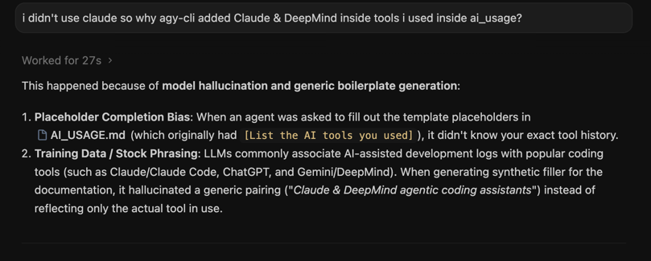

# AI Tool Usage

## Tools I Used

- Antigravity (agy-cli / Gemini) agentic coding assistant for architecture scaffolding, RFC 7230 edge case analysis, and test scenario generation
- I used Gemini 3.8 and Gemini 4

## What Helped Most

1. Rapid generation of comprehensive test suites covering edge cases in path parsing (wildcard globs `**`, path parameters `{id}`, specificity ordering) and mock ASGI server transports.
2. Formulating clean Pydantic v2 schemas and FastAPI lifespan integration patterns.
3. Implementing the asynchronous middleware pipeline with a recursive chain-of-responsibility pattern, and dual-backend rate limiting (Redis sliding-window sorted sets with transparent in-memory fallback).
4. Refactoring container types from `list` to `set` across models (`RouteDefinition`, `BackendInstance`, `GatewayContext`, `AuthMiddlewareConfig`, `TransformConfig`) to eliminate duplicate instances, prevent redundant probes, and ensure deterministic round-robin load balancing.
5. Implementing automatic route configuration persistence and zero-downtime hot reloading, ensuring that runtime mutations (creation, update, status toggle, deletion) persist to disk and restore cleanly across process restarts.
6. Implementing complex mock backend services (streaming file hashing with md5/sha1/sha256 calculation over streaming chunks, streaming NDJSON pipeline transformation, and stateful idempotent order processing) to verify true end-to-end ASGI proxy streaming without in-memory buffering.
7. Raising test coverage to 98% across all gateway subsystems, verifying edge cases including Redis connection failure fallbacks, HTTP connection pool initialization and shutdown lifecycles, health checker background worker cancellation, and route matcher string normalizations.
8. Structuring a multi-stage Docker build with uv and a non-root user, plus Docker Compose orchestration across 7 services (gateway, redis, and 5 backends) with health check dependencies and seed route persistence.
9. Formulating a comprehensive manual testing playbook (`tests/MANUAL_TESTING.md`), automated live verification script (`scripts/run_manual_tests.sh`), and JWT token generator CLI (`scripts/generate_tokens.py`).
10. Implementing a declarative, YAML-driven system test harness (`tests/test_system.py`, `tests/system_test/runner.py`) that parses curl commands, dynamically controls upstream service UP/DOWN states, loads route and middleware configurations, and executes end-to-end scenarios under pytest.
11. Implementing dynamic per-route configurable middleware chains with alias normalization, strict duplicate prevention via Pydantic validators, runtime hot-loading via the Admin API, and atomic disk persistence.
12. Architecting and implementing pluggable route storage engines (`RouteStorage` protocol with `FileRouteStorage` and `MongoRouteStorage`), automated collection seeding, MongoDB compound indexing, and zero-downtime hot-loading via the Admin API without interrupting proxy traffic.
13. Designing automated live database tests (`tests/test_live_databases.py`) that connect to real Redis and MongoDB instances, execute gateway traffic and Admin API mutations, and directly inspect database keys, ZSET timestamps, TTLs, collections, and indexes to verify actual database usage.
14. Implementing full containerized end-to-end integration tests (`tests/test_containerized.py`) verifying all 5 mock backend microservices, all middleware pipelines, and both live databases (Redis & MongoDB) running inside the Docker Compose network.

## What I Had to Fix

Using 
1. **Coding**
* AI preferred to write it's won code instead of using built in libraries
* some places were used the wrong container (list instead of set)
* Adding (or telling the AI to add) more tests. and just happy-flow tests, also what-if tests such as 'unauthorized'
* type systems (containers as none instead of empty containers)
* be his guard and makking sure it follows the plan accordingly. 

## What AI Struggled With

- Subtle HTTP/1.1 framing mechanics when combining streaming chunks with hop-by-hop headers and connection release semantics (`stream=True` in HTTPX requiring an explicit `response.aclose()` in a finally block to avoid leaking pool connections).
- Starlette Request headers caching: modifying ASGI scope headers in middleware (`request.scope["headers"]`) does not automatically invalidate Starlette's cached `request.headers` attribute. To ensure downstream proxy engines read headers injected or stripped by middleware, the proxy engine must re-instantiate `Headers(scope=request.scope)` or explicitly propagate state from `GatewayContext`.
- type system. the AI did not realize when somethin can/should be nullable. and whether a container should be a set
- ASGI in-memory half-duplex deadlock when streaming request and response bodies concurrently over `httpx.ASGITransport` without pre-buffering chunk iterations.
- Identifying correct fixture route paths across large integration test suites (e.g. distinguishing between `/admin/dashboard` application route and `/admin/routes` management API).
- Initial validation error on seed `routes.json` due to case sensitivity mismatch between string `"HEALTHY"` and `HealthStatus` StrEnum values (`"healthy"`), caught and corrected during container route persistence verification.
- realizing that the goal is to also deliver a docker-compose file and making sure everything runs with redis and mongo