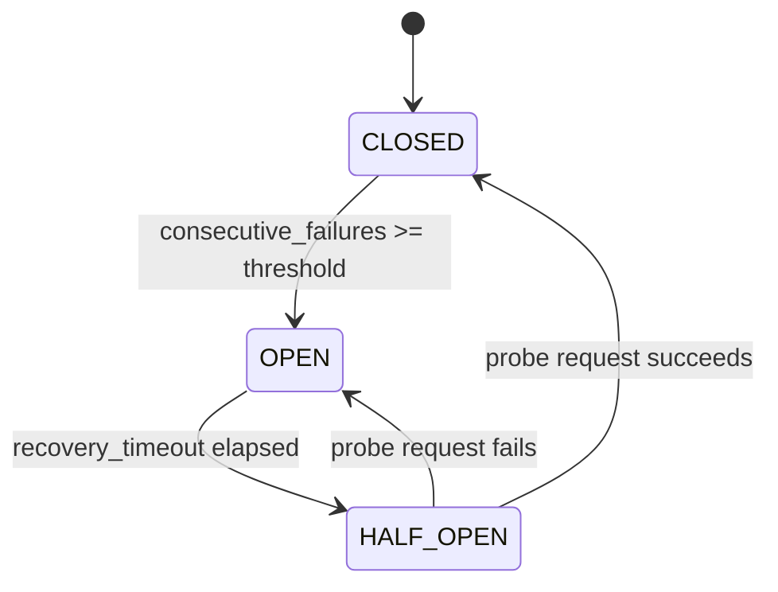

# Architectural & Technical Design Decisions

This document details the architectural choices, trade-offs, and design patterns implemented in the **Mountain API Gateway**.

---

## 1. Route Matching Strategy & Precedence

### Approach Chosen
Pre-compiled regular expressions scored by multi-attribute ranking:
$$\text{Precedence} = \text{Priority (explicit)} \longrightarrow \text{Specificity Score} \longrightarrow \text{Static Pattern Length}$$

### Why Regex with Deterministic Ordering?
API gateways must support varied URL patterns:
- Exact path matching: `/api/v1/health`
- Dynamic path parameters: `/users/{id}/profile`
- Single-segment wildcards: `/services/*/status`
- Recursive multi-segment globs: `/files/**`

Trie-based / Radix tree routing is efficient for exact prefix hierarchies, but adding arbitrary regex captures, wildcards, and variable path parameters within a single structure often results in non-deterministic routing or complicated backtracking.
By compiling route patterns into regular expressions during route registration and sorting the compiled routes list deterministically, matching achieves sub-millisecond evaluation with strict precedence guarantees.

### Resolving Overlapping Routes
1. **Explicit Priority**: Routes configured with a higher `priority` integer (e.g. 100 vs 0) always evaluate first. This allows operators to inject canary routes or emergency maintenance pages without mutating existing patterns.
2. **Specificity Score**:
   - Exact paths: `1000 + len(pattern)`
   - Single-segment wildcard (`*`) & parameter (`{param}`): `500 + prefix_len`
   - Recursive globs (`**`): `100 + prefix_len`
3. **Pattern Length Tie-breaker**: Longer static prefixes break ties when scores match (e.g. `/api/v1/users/**` beats `/api/**`).

### Path Normalization
Incoming request paths are normalized before matching:
- Leading slash enforced (`users` $\to$ `/users`)
- Consecutive slashes collapsed (`///api//v1///` $\to$ `/api/v1`)
- Trailing slashes stripped (`/items/` $\to$ `/items`) except for the root path (`/`).

---

## 2. Collection Uniqueness & Pydantic Data Modeling

### Why `set` Instead of `list` for Domain Collections
All unique domain collections use Python `set` (enforced via Pydantic `Field(default_factory=set)`):
- `RouteDefinition.methods`: Prevents duplicate HTTP methods (e.g. `{"GET", "POST"}`).
- `RouteDefinition.upstream_pool`: Prevents identical backend instances from being registered twice, avoiding duplicate health probes and skewed load balancing.
- `AuthMiddlewareConfig.allowed_roles` & `required_scopes`: Enables $O(1)$ set intersection checks during RBAC and scope evaluation.
- `TransformConfig.remove_request_headers`: $O(1)$ case-insensitive lookup when stripping sensitive client headers.
- `TargetPool.backends`: Guarantees pool uniqueness.

### Why `_compiled_routes` Remains a `list`
While route definitions are stored in a `dict[str, RouteDefinition]` by ID for $O(1)$ CRUD operations, the compiled routing table (`_compiled_routes`) **must remain an ordered `list`**.
Python `set` is unordered. If compiled routes were stored in a set, evaluation order would be non-deterministic, allowing wildcard routes (`/**`) to randomly intercept exact routes (`/health`).

### Strict Container Defaults
In Pydantic v2 models, container fields (`set`, `dict`, `list`) strictly default to empty collections (`default_factory=set`, `default_factory=dict`), never `None`. This eliminates redundant null checks (`if x is not None:`) throughout the gateway pipeline.

---

## 3. RFC 7230 Header Handling & State Propagation

### Strict Hop-by-Hop Header Stripping
Under RFC 7230 §6.1, hop-by-hop headers apply only to a single transport link and must not be forwarded:
- **Standard Hop-by-Hop**: `Connection`, `Keep-Alive`, `Proxy-Authenticate`, `Proxy-Authorization`, `TE`, `Trailers`, `Transfer-Encoding`, `Upgrade`.
- **Dynamic Hop-by-Hop Tokens**: Any header declared within the incoming `Connection` header value (e.g., `Connection: close, X-Custom-Token`) is dynamically stripped before proxying.
- **Content-Length on Streaming**: Stripped when streaming responses to prevent HTTP framing desynchronization when upstream backends transmit chunked data.

### Upstream Header Injection & Tracking
- `Host`: Re-written to the target backend's network authority (`host:port`) to ensure proper upstream virtual host routing.
- `X-Forwarded-For`: Appends the immediate client IP to any existing chain (`<existing>, <client_ip>`).
- `X-Forwarded-Host`: Preserves the client's original host.
- `X-Forwarded-Proto`: Preserves the client's request scheme (`http` / `https`).
- `X-Request-ID`: Propagates incoming trace ID or generates a new UUIDv4, forwarding it upstream and echoing it on client responses.

### Starlette Scope Headers Cache Invalidation
Modifying ASGI `scope["headers"]` in Starlette middleware does not invalidate Starlette's cached `request.headers` property. To ensure transformed headers are faithfully forwarded upstream, the proxy engine rebuilds headers directly from the active ASGI scope (`Headers(scope=request.scope)`).

---

## 4. True Streaming Proxy Engine & Zero-Buffering

### Memory Safety under High Concurrency
A core flaw of naive API gateways is reading request and response bodies entirely into memory (`await request.body()`). For large file uploads, multi-gigabyte downloads, or thousands of concurrent connections, buffering causes severe memory exhaustion (OOM).

### Implementation
- **Request Streaming**: `request.stream()` yields raw chunks directly to `httpx.AsyncClient.send(stream=True)`.
- **Response Streaming**: Starlette `StreamingResponse` streams incoming upstream chunks directly back to the client socket.
- **Connection Resource Management**: The upstream response streaming iterator is wrapped in a `try...finally` block executing `await response.aclose()` upon iterator termination or cancellation, guaranteeing zero connection pool leaks.

---

## 5. Service Discovery, Load Balancing & Circuit Breaker FSM



### Three-State Circuit Breaker FSM
Each backend instance or pool is protected by a circuit breaker:
- `CLOSED`: Normal operation. Failures increment `consecutive_failures`. If threshold is reached, trips to `OPEN`.
- `OPEN`: Traffic is immediately rejected or redirected to healthy peers. No requests are forwarded.
- `HALF_OPEN`: Once `recovery_timeout` has elapsed, a single canary request is admitted. Success resets the breaker to `CLOSED`; failure immediately trips back to `OPEN`.

### Deterministic Round-Robin
The `LoadBalancer` sorts healthy instances by their normalized URL before round-robin index calculation:
```python
healthy = sorted([b for b in pool if b.status == HealthStatus.HEALTHY], key=lambda b: b.url)
```
This guarantees deterministic instance rotation regardless of Python set iteration order.

### Background Health Checker
A background `asyncio.Task` polls `/health` on all registered backend instances at configurable intervals (`health_check_interval_seconds`). Instances failing consecutive probes are marked `UNHEALTHY` and removed from active load balancing without requiring client requests to trigger failure detection.

---

## 6. Dual-Tier Rate Limiting Architecture

### Distributed Sliding-Window with Redis
- Implemented using Redis sorted sets (`ZSET`) inside an atomic pipeline:
  1. Remove expired timestamps: `ZREMRANGEBYSCORE key 0 (now - window)`
  2. Count requests in active window: `ZCARD key`
  3. Fetch oldest timestamp in window: `ZRANGE key 0 0 WITHSCORES`
- If under limit:
  `ZADD key {now}:{uuid} now` and `EXPIRE key (window * 2)`.
- If over limit:
  Calculates exact `Retry-After` seconds based on the oldest record's timestamp.
- Unique member keys (`{timestamp}:{uuid}`) prevent timestamp collision overwrites under high-concurrency bursts.

### Transparent In-Memory Fallback
If the Redis cluster is unreachable, times out, or experiences a network partition, `RateLimitMiddleware` catches the exception and falls back to `InMemoryRateLimitEngine` without dropping user traffic.

---

## 7. Admin API & Atomic Restart Persistence

### Atomic Route Persistence
- All route modifications (`POST /admin/routes`, `PUT`, `DELETE`, `PATCH /status`) execute within an async lock and immediately flush the complete route table to disk atomically:
  ```python
  path.write_text(json.dumps(data, indent=2), encoding="utf-8")
  ```
- On gateway restart, `RouteRegistry.load_from_file()` restores all route definitions, backend pool instances, and middleware configurations.

### Zero-Downtime Hot Reload
- `POST /admin/routes/reload`: Re-reads configuration from disk and swaps the compiled routing table atomically without dropping in-flight connections or restarting the process.

---

## 8. Error Response Strategy & Information Masking

All error responses return clean, structured JSON envelopes conforming to RFC 7807 principles:
```json
{
  "error": "gateway_timeout",
  "message": "Upstream backend did not respond within 30.0s",
  "request_id": "c1f7a42b-9e48-4c8d-9372-87e07a389d41",
  "timestamp": "2026-10-27T22:30:00.000000Z"
}
```
- **Information Masking**: Internal Python stack traces, server IP addresses, and backend topology details are never exposed to clients.
- **Status Mapping**:
  - `504 Gateway Timeout`: Upstream exceeds timeout threshold.
  - `502 Bad Gateway`: Upstream connection refused, network unreachable, or process crash.
  - `401 Unauthorized`: Missing, expired, or cryptographically invalid JWT.
  - `403 Forbidden`: Valid JWT but missing required role or scope.
  - `404 Not Found`: No route pattern matched.
  - `405 Method Not Allowed`: Route exists but HTTP method not registered (returns `Allow` header).
  - `429 Too Many Requests`: Rate limit exhausted (returns `Retry-After` header).

---

## 10. Per-Route Configurable Middleware Chains & Duplicate Restriction

### Dynamic Middleware Ordering per Route
Rather than forcing all routes through a rigid global middleware order, routes can explicitly define an ordered `middleware_chain`:
```json
{
  "path_pattern": "/api/protected/**",
  "middleware_chain": ["rate_limit", "auth"]
}
```
- **Custom Execution Order**: Routes that prioritize burst defense can run `rate_limit` before `auth` (dropping throttled requests before cryptographic JWT verification). Routes that prioritize quota preservation run `auth` before `rate_limit`.
- **Targeted Bypass**: Omitted middlewares are cleanly bypassed for that route, avoiding redundant checks.
- **Backward Compatibility**: Routes without an explicit `middleware_chain` default to standard full pipeline execution governed by `middleware.<type>.enabled`.

### Strict Duplicate Restriction
A route cannot configure duplicate middleware instances (e.g. configuring `auth` twice or `rate_limit` twice).
- **Validation**: Enforced during Pydantic schema validation (`@field_validator("middleware_chain")`).
- **Canonical Aliases**: Normalizes common aliases (e.g. `jwt` $\to$ `auth`, `ratelimit` $\to$ `rate_limit`), preventing duplicate injection via different naming conventions.
- **Rejection**: Attempting to register a route with duplicate middlewares returns `422 Unprocessable Entity`.

---

## 11. Pluggable Route Storage Backends (File & MongoDB) with Hot-Loading

### Storage Decoupling Architecture
Route persistence and registry operations are decoupled from physical storage mediums via the `RouteStorage` abstract base class (`gateway/storage/base.py`):
- `FileRouteStorage`: Atomic disk file writes using temporary files and directory rename operations.
- `MongoRouteStorage`: Asynchronous persistence via MongoDB (`motor` driver) with compound indexing on `path_pattern` and `enabled`.
- `create_route_storage`: Factory pattern abstracting storage instantiation based on environment configuration (`GATEWAY_STORAGE_BACKEND`).

### Zero-Downtime Hot-Loading
- **Startup Seeding**: When MongoDB starts with an empty collection, it automatically seeds initial route definitions from the configured seed file (`GATEWAY_SEED_ROUTES_FILE`), ensuring immediate out-of-the-box readiness.
- **Admin Hot-Loading**: Mutations made via the Admin API (`POST /admin/routes`, `PUT`, `DELETE`, `PATCH /status`) persist directly to the active storage engine while immediately updating the in-memory `RouteMatcher`.
- **Hot-Reload Trigger**: The `POST /admin/routes/reload` endpoint re-syncs the in-memory registry with the underlying storage backend without process restarts.

---

## 12. Future Production Improvements

1. **Kernel Zero-Copy Splicing**: Utilize Linux `splice(2)` / `vmsplice` via epoll to pipe sockets directly in kernel space for multi-gigabit throughput.
2. **HTTP/2 & HTTP/3 Multiplexing**: Support end-to-end multiplexed upstream connections over single TCP/QUIC sessions.
3. **Distributed Raft Synchronization**: Replace single-instance storage with distributed consensus (e.g. etcd, HashiCorp Consul, or internal Raft) for multi-node gateway clusters.
