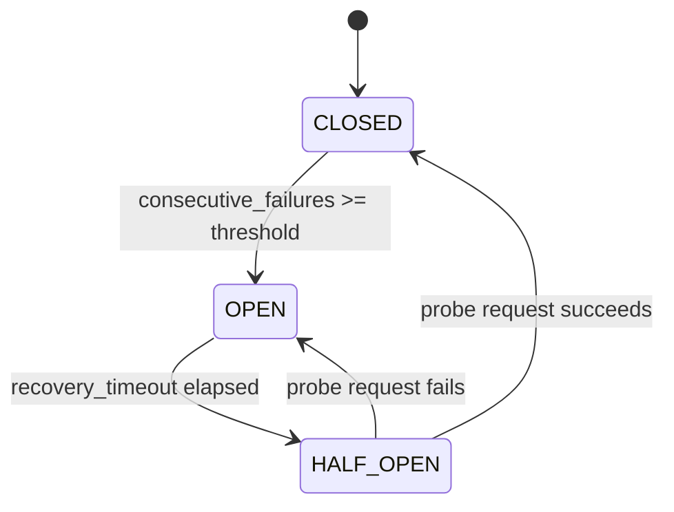

# Design Decisions

This document details the architectural choices, trade-offs, and design patterns implemented in the **Mountain API Gateway**, directly addressing the assignment specification questions followed by deep subsystem analyses.

---

## 1. Route Matching Strategy

**Approach chosen:**
Pre-compiled regular expressions scored by multi-attribute deterministic ranking:
$$\text{Precedence} = \text{Priority (explicit)} \longrightarrow \text{Specificity Score} \longrightarrow \text{Static Pattern Length}$$

**Why:**
API gateways must support varied URL patterns:
- Exact path matching: `/api/v1/health`
- Dynamic path parameters: `/users/{id}/profile`
- Single-segment wildcards: `/services/*/status`
- Recursive multi-segment globs: `/files/**`

Trie-based / Radix tree routing is efficient for exact prefix hierarchies, but adding arbitrary regex captures, wildcards, and variable path parameters within a single structure often results in non-deterministic routing or complicated backtracking.
By compiling route patterns into regular expressions during route registration and sorting the compiled routes list deterministically, matching achieves sub-millisecond evaluation with strict precedence guarantees.

**Overlapping routes resolved by:**
1. **Explicit Priority**: Routes configured with a higher `priority` integer (e.g. `100` vs `0`) always evaluate first, allowing canary routes or emergency maintenance pages without mutating existing patterns.
2. **Specificity Score**:
   - Exact paths: `1000 + len(pattern)`
   - Single-segment wildcard (`*`) & parameter (`{param}`): `500 + prefix_len`
   - Recursive globs (`**`): `100 + prefix_len`
3. **Pattern Length Tie-breaker**: Longer static prefixes break ties when scores match (e.g. `/api/v1/users/**` beats `/api/**`).
4. **Path Normalization**: Incoming paths are normalized prior to matching by collapsing consecutive slashes (`///api//v1///` $\to$ `/api/v1`) and stripping non-root trailing slashes.

---

## 2. Header Handling

**Forwarded headers:**
- All standard client request headers (e.g. `Accept`, `Content-Type`, `User-Agent`, `Authorization`, `X-Custom-*`) are preserved and forwarded to the backend service unless specifically identified as hop-by-hop or stripped by route transform rules.
- Upstream response headers (e.g. `Content-Type`, `ETag`, `Cache-Control`) are forwarded back to the client.

**Stripped headers:**
- **RFC 7230 §6.1 Hop-by-Hop Headers**: `Connection`, `Keep-Alive`, `Proxy-Authenticate`, `Proxy-Authorization`, `TE`, `Trailers`, `Transfer-Encoding`, `Upgrade`.
- **Dynamic Hop-by-Hop Tokens**: Any header declared within the incoming `Connection` header value (e.g. `Connection: close, X-Custom-Token`) is parsed and stripped before forwarding.
- **Client `Host` Header**: Never forwarded directly; replaced with target backend's network authority (`host:port`).
- **`Content-Length` on Streaming**: Stripped on streaming responses to prevent framing desynchronization when upstream backends transmit chunked data.
- **Route-Configured Removals**: Any headers explicitly specified in `remove_request_headers` or `remove_response_headers`.

**Added headers:**
- **Proxy Identity & Traceability**:
  - `Host`: Set to the target backend's network authority (`host:port`).
  - `X-Forwarded-For`: Appends client IP to any existing chain (`<existing>, <client_ip>`).
  - `X-Forwarded-Host`: Preserves client's original host.
  - `X-Forwarded-Proto`: Preserves client's request scheme (`http` / `https`).
  - `X-Real-IP`: Client direct IP address.
  - `X-Request-ID`: Propagates incoming trace ID or generates a new UUIDv4 (echoed back in response).
- **Authenticated Identity**: `X-User-Id` and `X-User-Roles` injected from verified JWT token payload.
- **Gateway Timing**: `X-Response-Time` (e.g. `12.34ms`) and `Server-Timing` (e.g. `gateway;dur=12.34`).
- **CORS Headers**: `Access-Control-Allow-Origin`, `Access-Control-Allow-Methods`, `Access-Control-Allow-Headers`, `Access-Control-Max-Age`, and optionally `Access-Control-Allow-Credentials`.
- **Rate Limit Headers**: `X-RateLimit-Limit`, `X-RateLimit-Remaining`, `X-RateLimit-Reset`, and `Retry-After` (on 429).

---

## 3. Middleware Chain Design

**Approach chosen:**
Asynchronous Chain-of-Responsibility pattern using recursive closures (`dispatch(index, request, context)`). Each middleware accepts `(request, context, call_next)` and can inspect, modify, delegate to `call_next`, or short-circuit.

**Ordering:**
- **Default Pipeline Order**:
  $$\text{Metrics/Logging} \longrightarrow \text{Auth (JWT/RBAC)} \longrightarrow \text{Rate Limiting} \longrightarrow \text{Request Transform} \longrightarrow \text{Proxy Engine} \longrightarrow \text{Response Transform}$$
- **Per-Route Configurable Chains**: Routes can specify an explicit ordered `middleware_chain` (or `middlewares`), such as `["rate_limit", "auth"]`.
  - When specified, global observability (metrics) executes first, followed by the route's custom middleware order.
  - Omitted middlewares are cleanly bypassed.
  - Duplicates are strictly rejected via Pydantic validators with canonical alias resolution (`jwt` $\to$ `auth`, `ratelimit` $\to$ `rate_limit`).

**Data passing between middleware:**
- Strong typed ASGI request-scoped context: `GatewayContext`.
- Propagates `request_id`, `client_ip`, `start_time`, `matched_route`, `user_id`, `user_roles`, and `custom_state` across the entire pipeline without monkey-patching globals or ASGI scope.
- Downstream headers are reflected into ASGI `scope["headers"]` and re-read via `Headers(scope=request.scope)` to prevent Starlette headers caching inconsistencies.

---

## 4. Error Response Strategy

**Backend timeout:**
- Status Code: `504 Gateway Timeout`
- Returned JSON envelope:
  ```json
  {
    "error": "gateway_timeout",
    "message": "Upstream backend did not respond within 30.0s",
    "request_id": "c1f7a42b-9e48-4c8d-9372-87e07a389d41",
    "timestamp": "2026-10-28T03:00:00.000000Z"
  }
  ```

**Backend error:**
- Status Code: `502 Bad Gateway` (for upstream connection refused, socket resets, process crashes) or `503 Service Unavailable` (when all backend instances in the pool are unhealthy).
- Returned JSON envelope:
  ```json
  {
    "error": "bad_gateway",
    "message": "Failed to connect to upstream backend",
    "request_id": "c1f7a42b-9e48-4c8d-9372-87e07a389d41",
    "timestamp": "2026-10-28T03:00:00.000000Z"
  }
  ```

**Information exposure:**
- **Zero Stack Trace Leakage**: Internal Python tracebacks, file system paths, exception names, and database connection strings are never sent to the client.
- **Topology Masking**: Private upstream IP addresses, ports, and internal DNS names are omitted from error payloads.
- **Correlation ID**: Every error response includes `request_id` and `timestamp`, allowing operators to locate full debug logs in Elasticsearch/stdout while keeping client payloads opaque and secure.

---

## 5. One Thing I Would Do Differently With More Time

**Distributed Consensus & Cluster State Synchronization:**
While the gateway implements pluggable storage (MongoDB and atomic file persistence) and Redis-backed sliding-window rate limiting, in a multi-region or multi-cluster Kubernetes deployment, route cache invalidation across distributed gateway pods currently relies on polling or an explicit Admin API reload trigger (`POST /admin/routes/reload`).
With more time, I would implement:
1. **Redis Pub/Sub or Raft Consensus Invalidation**: Broadcast route mutation events to all gateway worker processes in real time so that route updates propagate with sub-millisecond cluster consistency.
2. **Kernel Zero-Copy Splicing**: Utilize Linux `splice(2)` / `vmsplice` via epoll to pipe incoming client TCP sockets directly to upstream backend sockets in kernel space, eliminating user-space memory copies for multi-gigabit file streaming.
3. **HTTP/2 & HTTP/3 Upstream Multiplexing**: Keep single persistent multiplexed TCP/QUIC connections to backend pools rather than HTTP/1.1 keep-alive connection pooling.

---

## 6. Collection Uniqueness & Pydantic Data Modeling

### Why `set` Instead of `list` for Domain Collections
All unique domain collections use Python `set` (enforced via Pydantic `Field(default_factory=set)`):
- `RouteDefinition.methods`: Prevents duplicate HTTP methods (e.g. `{"GET", "POST"}`).
- `RouteDefinition.upstream_pool`: Prevents identical backend instances from being registered twice, avoiding duplicate health probes and skewed load balancing.
- `AuthMiddlewareConfig.allowed_roles` & `required_scopes`: Enables $O(1)$ set intersection checks during RBAC and scope evaluation.
- `TransformConfig.remove_request_headers` & `remove_response_headers`: $O(1)$ case-insensitive lookup when stripping headers.
- `TargetPool.backends`: Guarantees pool uniqueness.

### Why `_compiled_routes` Remains a `list`
While route definitions are stored in a `dict[str, RouteDefinition]` by ID for $O(1)$ CRUD operations, the compiled routing table (`_compiled_routes`) **must remain an ordered `list`**.
Python `set` is unordered. If compiled routes were stored in a set, evaluation order would be non-deterministic, allowing wildcard routes (`/**`) to randomly intercept exact routes (`/health`).

### Strict Container Defaults
In Pydantic v2 models, container fields (`set`, `dict`, `list`) strictly default to empty collections (`default_factory=set`, `default_factory=dict`), never `None`. This eliminates redundant null checks (`if x is not None:`) throughout the gateway pipeline.

---

## 7. True Streaming Proxy Engine & Zero-Buffering

### Memory Safety under High Concurrency
A core flaw of naive API gateways is reading request and response bodies entirely into memory (`await request.body()`). For large file uploads, multi-gigabyte downloads, or thousands of concurrent connections, buffering causes severe memory exhaustion (OOM).

### Implementation
- **Request Streaming**: `request.stream()` yields raw chunks directly to `httpx.AsyncClient.send(stream=True)`.
- **Response Streaming**: Starlette `StreamingResponse` streams incoming upstream chunks directly back to the client socket via `upstream_resp.aiter_raw()`.
- **Connection Resource Management**: The upstream response streaming iterator is wrapped in a `try...finally` block executing `await response.aclose()` upon iterator termination or cancellation, guaranteeing zero connection pool leaks.

---

## 8. Service Discovery, Load Balancing & Circuit Breaker FSM



### Three-State Circuit Breaker FSM
Each backend instance or pool is protected by a circuit breaker:
- `CLOSED`: Normal operation. Failures increment `consecutive_failures`. If threshold is reached, trips to `OPEN`.
- `OPEN`: Traffic is immediately rejected or redirected to healthy peers. No requests are forwarded.
- `HALF_OPEN`: Once `recovery_timeout` has elapsed, a single canary request is admitted. Success resets the breaker to `CLOSED`; failure immediately trips back to `OPEN`.

### Deterministic Round-Robin
The `LoadBalancer` sorts healthy instances by their normalized URL before round-robin index calculation:
```python
healthy = sorted([b for b in pool if b.status == HealthStatus.HEALTHY], key=lambda b: b.url)
```
This guarantees deterministic instance rotation regardless of Python set iteration order.

### Background Health Checker
A background `asyncio.Task` polls health check endpoints on all registered backend instances at configurable intervals (`health_check_interval_seconds`). Instances failing consecutive probes are marked `UNHEALTHY` and removed from active load balancing without requiring client requests to trigger failure detection.

---

## 9. Dual-Tier Rate Limiting Architecture

### Distributed Sliding-Window with Redis
- Implemented using Redis sorted sets (`ZSET`) inside an atomic pipeline:
  1. Remove expired timestamps: `ZREMRANGEBYSCORE key 0 (now - window)`
  2. Count requests in active window: `ZCARD key`
  3. Fetch oldest timestamp in window: `ZRANGE key 0 0 WITHSCORES`
- If under limit:
  `ZADD key {now}:{uuid} now` and `EXPIRE key (window * 2)`.
- If over limit:
  Calculates exact `Retry-After` seconds based on the oldest record's timestamp.
- Unique member keys (`{timestamp}:{uuid}`) prevent timestamp collision overwrites under high-concurrency bursts.

### Transparent In-Memory Fallback
If the Redis cluster is unreachable, times out, or experiences a network partition, `RateLimitMiddleware` catches the exception and falls back to `InMemoryRateLimitEngine` without dropping user traffic.

---

## 10. Admin API & Atomic Restart Persistence

### Atomic Route Persistence
- All route modifications (`POST /admin/routes`, `PUT`, `DELETE`, `PATCH /status`) execute within an async lock and immediately flush the complete route table to disk atomically:
  ```python
  path.write_text(json.dumps(data, indent=2), encoding="utf-8")
  ```
- On gateway restart, `RouteRegistry.load_from_file()` restores all route definitions, backend pool instances, and middleware configurations.

### Zero-Downtime Hot Reload
- `POST /admin/routes/reload`: Re-reads configuration from disk and swaps the compiled routing table atomically without dropping in-flight connections or restarting the process.

---

## 11. Per-Route Configurable Middleware Chains & Duplicate Restriction

### Dynamic Middleware Ordering per Route
Rather than forcing all routes through a rigid global middleware order, routes can explicitly define an ordered `middleware_chain`:
```json
{
  "path_pattern": "/api/protected/**",
  "middleware_chain": ["rate_limit", "auth"]
}
```
- **Custom Execution Order**: Routes that prioritize burst defense can run `rate_limit` before `auth` (dropping throttled requests before cryptographic JWT verification). Routes that prioritize quota preservation run `auth` before `rate_limit`.
- **Targeted Bypass**: Omitted middlewares are cleanly bypassed for that route, avoiding redundant checks.
- **Backward Compatibility**: Routes without an explicit `middleware_chain` default to standard full pipeline execution governed by `middleware.<type>.enabled`.

### Strict Duplicate Restriction
A route cannot configure duplicate middleware instances (e.g. configuring `auth` twice or `rate_limit` twice).
- **Validation**: Enforced during Pydantic schema validation (`@field_validator("middleware_chain")`).
- **Canonical Aliases**: Normalizes common aliases (e.g. `jwt` $\to$ `auth`, `ratelimit` $\to$ `rate_limit`), preventing duplicate injection via different naming conventions.
- **Rejection**: Attempting to register a route with duplicate middlewares returns `422 Unprocessable Entity`.

---

## 12. Pluggable Route Storage Backends (File & MongoDB) with Hot-Loading

### Storage Decoupling Architecture
Route persistence and registry operations are decoupled from physical storage mediums via the `RouteStorage` abstract base class (`gateway/storage/base.py`):
- `FileRouteStorage`: Atomic disk file writes using temporary files and directory rename operations.
- `MongoRouteStorage`: Asynchronous persistence via MongoDB (`motor` driver) with compound indexing on `path_pattern` and `enabled`.
- `create_route_storage`: Factory pattern abstracting storage instantiation based on environment configuration (`GATEWAY_STORAGE_BACKEND`).

### Zero-Downtime Hot-Loading
- **Startup Seeding**: When MongoDB starts with an empty collection, it automatically seeds initial route definitions from the configured seed file (`GATEWAY_SEED_ROUTES_FILE`), ensuring immediate out-of-the-box readiness.
- **Admin Hot-Loading**: Mutations made via the Admin API (`POST /admin/routes`, `PUT`, `DELETE`, `PATCH /status`) persist directly to the active storage engine while immediately updating the in-memory `RouteMatcher`.
- **Hot-Reload Trigger**: The `POST /admin/routes/reload` endpoint re-syncs the in-memory registry with the underlying storage backend without process restarts.

---

## 13. Structured Logging Architecture: Dual-Mode Console & ECS/Prometheus

### Dual Logging Engines for Different Consumers
API Gateway observability serves two fundamentally different consumers:
1. **Human Operators & LLMs in Terminal**: Need concise, visually aligned, color-coded, single-line logs that can be quickly scanned during development, CLI debugging, and automated code review.
2. **Log Aggregators & SIEMs (Elasticsearch, Logstash, Datadog, Vector)**: Require single-line NDJSON strictly complying with the [Elastic Common Schema (ECS)](https://www.elastic.co/guide/en/ecs/current/index.html) for fast indexation, filtering, and cross-service distributed tracing.

### Core Design Decisions
- **Unified Extensible Record**: Standard Python `LogRecord` objects with structured dictionary attributes in `extra` (e.g. `http_method`, `path`, `status_code`, `duration_ms`, `route_id`, `client_ip`, `user_id`, `request_id`).
- **Elastic Common Schema (ECS) Compliance**:
  - `@timestamp`: ISO-8601 UTC timestamp with millisecond precision (`YYYY-MM-DDTHH:MM:SS.sssZ`).
  - `log.level`, `log.logger`: Standard ECS log fields.
  - `service.name`, `service.version`: Service identity metadata.
  - `trace.id`: Distributed trace identifier (`x-request-id`), correlating gateway logs with upstream backend traces.
  - `http.request.method`, `http.response.status_code`, `http.response.duration_ms`: Standardized HTTP dimensions.
- **Prometheus Metric Dimension Correlation**:
  - The JSON formatter embeds `prometheus.metric` and `prometheus.labels` (`method`, `route_id`, `status_code`) directly within HTTP access log records.
- **Clean Console Formatter**:
  - Aligned terminal columns:
    `[timestamp] [LEVEL] [logger] [req-id] METHOD /path -> STATUS (duration_ms) | route=... ip=... user=...`
  - Automatically checks `sys.stdout.isatty()` to disable ANSI escape codes when redirected to files or captured in CI pipes.
- **Environment Toggle**:
  - Selected via `GATEWAY_LOG_FORMAT=console|json`. Default is `console` for local runs, and `json` for containerized and production deployments.
