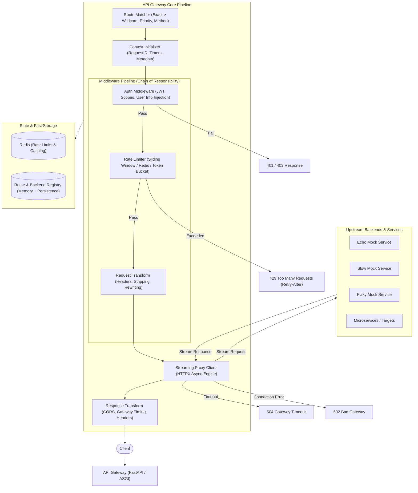
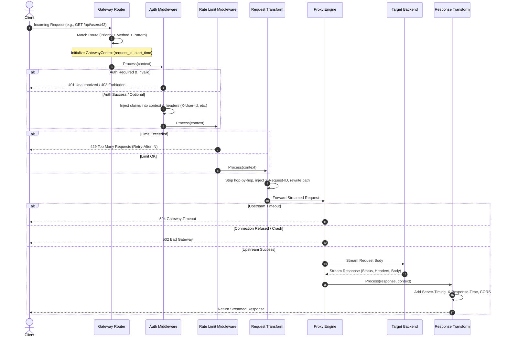

# API Gateway: Architecture & Implementation Plan

> **Role & Level:** Mid/Senior Backend Engineer Assessment  
> **Evaluation Focus:** Correctness of proxying & header handling, extensible middleware architecture, edge cases, trade-offs, and critical assessment of AI suggestions.

---

## 0. Phase 0: Infrastructure & Tooling Foundation [DONE]

- **Package & Dependency Management:** `pyproject.toml` (PEP 621) driven by `uv`.
- **Formatting & Linting:** `ruff` (configured for clean Python 3.12+ syntax, 100 character line limit, strict import sorting and code quality rules).
- **Static Type Checking:** `pyright` (standard mode, Python 3.14 compatible, strict typing across `gateway/`, `mock_backend_services/`, and `tests/`).
- **Durable Redis Storage:** Redis configured with Append-Only File (AOF) persistence (`appendonly yes`, `appendfsync everysec`, `save 60 1`) and mounted persistent Docker volume (`redis_data:/data`) so rate limits, token buckets, and backend circuit states survive container restarts.
- **Code Readability Guidelines:** Minimal commentary, zero LLM explanatory boilerplate; highly readable, intention-revealing naming, domain schemas, and clean single-responsibility functions.

---

## 1. System Architecture Overview



---

## 2. Critical Architectural Traps (What Interviewers Hunt For)

The assignment explicitly notes:
> *"API gateways have subtle correctness requirements that AI often misses. We're evaluating your ability to critically assess AI suggestions."*

Here are the exact pitfalls we must explicitly address in code and in `DECISIONS.md` / `AI_USAGE.md`:

| Area | The Naive / AI Trap | The Senior Engineer / Production Solution |
| :--- | :--- | :--- |
| **Body Streaming** | `await request.body()` reads the full payload into gateway memory before proxying. Breaks on 500MB uploads and triggers Out-Of-Memory (OOM) crashes. | **True ASGI / HTTP streaming:** stream request chunks (`request.stream()`) directly into the upstream connection and stream response chunks (`response.aiter_raw()`) directly back to the client via `StreamingResponse`. |
| **Hop-by-Hop Headers** | Forwarding raw incoming client headers directly upstream. Forwarding `Connection`, `Keep-Alive`, `Transfer-Encoding`, or `Upgrade` corrupts HTTP/1.1 and HTTP/2 framing. | **RFC 7230 §6.1 Stripping:** Strip all hop-by-hop headers (`Connection`, `Keep-Alive`, `Proxy-Authenticate`, `Proxy-Authorization`, `TE`, `Trailers`, `Transfer-Encoding`, `Upgrade`). Also strip headers listed inside the `Connection` header value itself. |
| **Content-Length vs Chunked** | When streaming, leaving a stale or mismatched `Content-Length` header causes request hanging or truncation. | When streaming without a known length or when transforming payloads, delete `Content-Length` and let chunked transfer encoding handle it. |
| **Host Header** | Blindly forwarding the incoming `Host` header to upstream backends. Backends using virtual hosts or SNI will reject or misroute the request. | Rewrite `Host` to match target backend host, while preserving original host in `X-Forwarded-Host`. |
| **Client IP Tracking** | Blindly setting `X-Forwarded-For: client_ip` overwrites existing proxy chains, or trusting untrusted upstream headers enables IP spoofing. | Append the immediate client IP to `X-Forwarded-For` (`<existing>, <client_ip>`), and set `X-Real-IP`. |
| **Client Identification for Rate Limits** | Rate limiting only by IP (breaks for users behind corporate NATs) or only by user ID (fails for unauthenticated public routes). | **Hierarchical Identity:** If authenticated, use `user_id`; if API key provided, use `api_key`; fallback to client IP. |
| **Error Masking** | Returning Python traceback or internal backend connection strings to the client. | Clean, structured error JSON with a unified schema (`error`, `message`, `request_id`, `timestamp`), logging the root cause internally with trace IDs. Return **504** on timeout, **502** on backend connection drops. |

---

## 3. High-Level Modular Design

```
mountain_api_gateway/
├── gateway/
│   ├── __init__.py
│   ├── main.py                  # ASGI entry point & lifecycle (startup/shutdown)
│   ├── config.py                # Environment & Gateway configuration
│   ├── models/
│   │   ├── __init__.py
│   │   ├── route.py             # RouteDefinition, MiddlewareConfig, MatchResult
│   │   ├── backend.py           # BackendInstance, HealthStatus, TargetPool
│   │   └── context.py           # GatewayContext (holds request lifecycle state)
│   ├── routing/
│   │   ├── __init__.py
│   │   ├── matcher.py           # Path matching (exact, prefix, wildcard, regex) & priority
│   │   └── registry.py          # Dynamic route store & hot reload
│   ├── middleware/
│   │   ├── base.py              # BaseMiddleware interface & Pipeline orchestrator
│   │   ├── auth.py              # JWT validation, claims extraction, scope enforcement
│   │   ├── rate_limit.py        # Token bucket / Sliding window (Redis + In-memory fallback)
│   │   ├── request_transform.py # Header manipulation, X-Request-ID, path rewrite
│   │   ├── response_transform.py# Gateway timing, CORS injection, custom response headers
│   │   └── metrics.py           # Latency tracking, Prometheus counters/histograms
│   ├── proxy/
│   │   ├── __init__.py
│   │   ├── client.py            # Async HTTP client pool with connection limits & timeouts
│   │   ├── streaming.py         # Request & Response streaming handlers
│   │   └── headers.py           # Hop-by-hop stripping, X-Forwarded-* management
│   ├── discovery/
│   │   ├── __init__.py
│   │   ├── health_checker.py    # Periodic background health probes
│   │   └── load_balancer.py     # Round-robin & circuit breaker for multi-backend routes
│   └── admin/
│       ├── __init__.py
│       └── routes.py            # Admin REST API: CRUD routes, health, stats, reload
├── mock_backend_services/
│   ├── __init__.py
│   ├── echo_service.py          # Returns received method, path, headers, query, body
│   ├── slow_service.py          # Configurable delay endpoint for timeout testing
│   └── flaky_service.py         # Configurable failure rate endpoint for error testing
├── tests/
│   ├── conftest.py              # Shared fixtures, test client, mock backends, JWT helpers
│   ├── test_route_matching.py   # Exact, wildcard, priority, method filters
│   ├── test_auth_middleware.py  # Valid, expired, invalid, optional, scopes
│   ├── test_rate_limiting.py    # Limits, headers (429, Retry-After, Limit, Remaining)
│   ├── test_request_proxying.py # Full proxying, body streaming, HTTP methods
│   ├── test_header_transform.py # Hop-by-hop stripping, X-Request-ID, X-Forwarded-*
│   ├── test_error_handling.py   # Backend down (502), timeout (504), clean error schemas
│   ├── test_service_discovery.py# Round-robin, health checks, circuit breaker
│   └── test_admin_api.py        # Route creation, listing, updating, deletion, hot-reloading
├── Dockerfile                   # Multi-stage production Dockerfile
├── docker-compose.yml           # Gateway + Redis + Echo + Slow + Flaky services
├── DECISIONS.md                 # Required design decision document
├── AI_USAGE.md                  # Required AI reflections document
├── README.md                    # Setup, running, testing, architecture, examples
└── requirements.txt             # Clean, pinned dependencies
```

---

## 4. Middleware Pipeline Specification



---

## 5. Step-by-Step Implementation Phases

### Phase 1: Core Foundation & Data Models
- Define Pydantic models for `Route`, `Backend`, `MiddlewareConfig`, and `GatewayContext`.
- Build the `RouteMatcher` with support for exact matching, prefix matching, wildcard patterns (`/api/users/*`), priority scoring, and HTTP method filtering.
- Implement in-memory + file-persisted `RouteRegistry` with concurrency-safe reads/writes.

### Phase 2: Request Proxying & Header Handling Engine
- Build the streaming proxy engine using `httpx.AsyncClient` with connection pooling.
- Implement strict RFC 7230 hop-by-hop header stripping and `Host` header sanitization.
- Support request path rewriting (`strip_prefix`, `add_prefix`).
- Implement timeout management (per-route or global default) with 504 responses.
- Implement connection failure handling with 502 responses.

### Phase 3: Middleware Subsystem
- **Base Middleware Interface**: Clean asynchronous execution pipeline (`execute(context, call_next)`).
- **Authentication Middleware**: JWT verification (`HS256`/`RS256`), optional vs required auth, role/scope validation, and upstream user header injection (`X-User-Id`, `X-User-Roles`).
- **Rate Limiting Middleware**: Sliding window rate limiter with Redis backend and seamless fast in-memory fallback. Injects standard rate limit headers (`X-RateLimit-Limit`, `X-RateLimit-Remaining`, `X-RateLimit-Reset`, `Retry-After`).
- **Request Transform Middleware**: Dynamic header injection/removal, `X-Request-ID` generation/propagation.
- **Response Transform Middleware**: CORS headers, gateway latency measurement (`Server-Timing`, `X-Response-Time`).
- **Logging & Metrics Middleware**: Structured JSON access logs, Prometheus metrics (`/metrics`).

### Phase 4: Service Discovery, Load Balancing & Health Checks
- Background async task for backend health polling at configured intervals.
- Round-robin load balancer over healthy backend instances.
- Basic Circuit Breaker pattern (tripping to open state on consecutive failures).

### Phase 5: Admin API & Hot Configuration Reload
- Dynamic route CRUD endpoints:
  - `POST /admin/routes`, `GET /admin/routes`, `GET /admin/routes/{id}`, `PUT /admin/routes/{id}`, `DELETE /admin/routes/{id}`
  - Route enable/disable toggling (`PATCH /admin/routes/{id}/status`).
- Gateway health & stats endpoint (`GET /admin/health`, `GET /admin/stats`).
- Backend inventory & health status (`GET /admin/backends`).
- Instant config reload without process restart (`POST /admin/routes/reload`).

### Phase 6: Mock Backend Services
- **Echo Service**: Returns request metadata (method, headers, query, body, client info).
- **Slow Service**: Configurable delay parameter (`?delay=X`) for timeout verification.
- **Flaky Service**: Configurable error rate (`?fail_rate=0.5`) returning HTTP 500.

### Phase 7: Comprehensive Test Suite (Exceeding the 6 Requirements)
- `test_route_matching.py`: Exact paths, wildcards, priority ties, method validation, disabled routes.
- `test_auth_middleware.py`: Valid token, expired token, missing token, optional auth pass-through, missing scopes.
- `test_rate_limiting.py`: Burst limit, 429 response status, `Retry-After` header correctness, IP vs user-based identity.
- `test_request_proxying.py`: GET/POST/PUT/DELETE, query params, streaming payload integrity, path rewriting (`strip_prefix`).
- `test_header_transform.py`: Hop-by-hop headers stripped, `X-Request-ID` generation and propagation, `X-Forwarded-For` chain.
- `test_error_handling.py`: Backend timeout -> 504, backend crash -> 502, no internal stack leaks.
- `test_service_discovery.py`: Round-robin distribution, marking dead backends unhealthy, traffic bypass.
- `test_admin_api.py`: Route creation, listing, updating, deletion, hot-reloading.

### Phase 8: Containerization & Documentation
- Multi-service `docker-compose.yml` (Gateway, Redis, Echo, Slow, Flaky, Hasher, Pipeline).
- Optimized production `Dockerfile`.
- Complete, interview-ready `DECISIONS.md`, `README.md`, and `AI_USAGE.md`.

### Phase 9: Manual Testing Playbook & Automated Demonstration Harness
- `tests/MANUAL_TESTING.md`: Comprehensive step-by-step interactive manual testing playbook.
- `scripts/run_manual_tests.sh`: Automated live execution script testing all scenarios.
- `scripts/generate_tokens.py`: Developer CLI tool to mint test JWT tokens on demand.

---

## 6. Verification & Demonstration Checklist

- [ ] All tests pass locally with `pytest -v`.
- [ ] `docker compose up --build` brings up all services cleanly.
- [ ] Live `curl` demonstrations documented for:
  - Routing & path rewriting
  - JWT auth (success & forbidden)
  - Rate limiting (429 & Retry-After)
  - Timeout trigger on Slow service (504)
  - Failover / Flaky service handling (502)
  - Admin API route modification & hot reload
