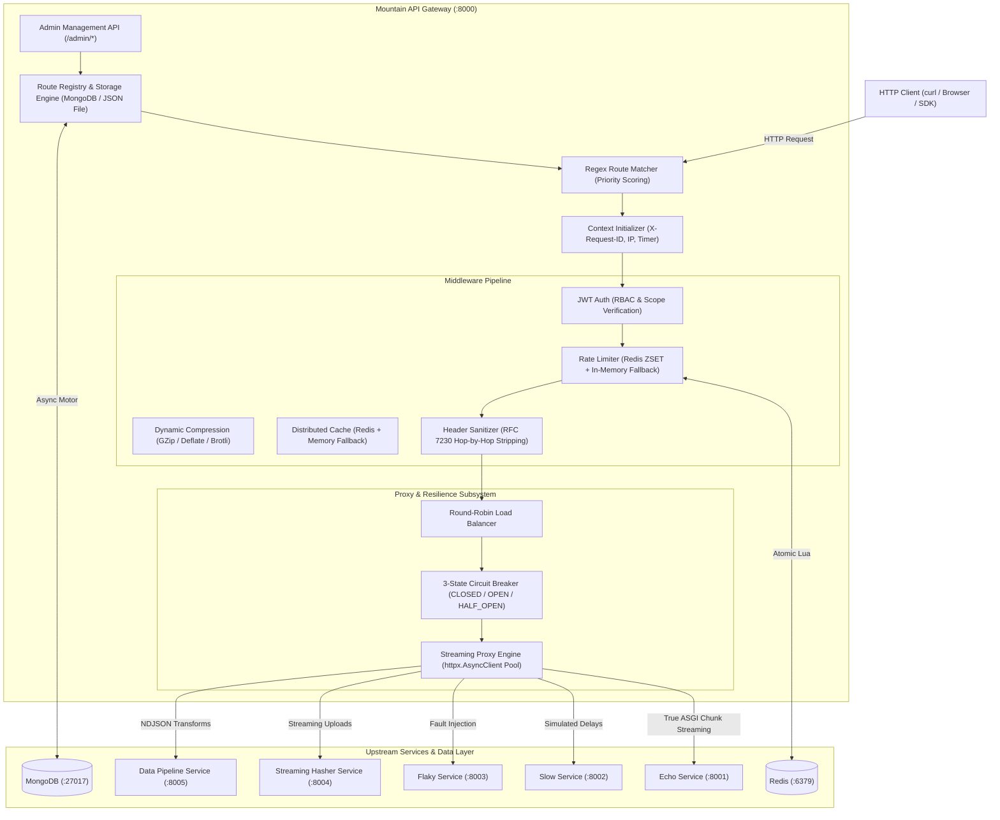

# Mountain API Gateway

[](https://www.python.org/)
[](LICENSE)
[]()
[]()
[](https://github.com/astral-sh/ruff)
[](https://github.com/microsoft/pyright)

A lightweight, production-grade, and high-performance API Gateway built with **Python 3.14 / 3.12**, **FastAPI**, **HTTPX**, and **Pydantic v2**, driven by **uv**. Designed for low-latency request dispatching, true end-to-end ASGI body chunk streaming, distributed sliding-window rate limiting, circuit breaker fault tolerance, and zero-downtime hot configuration reloads.

---

## 1. System Architecture



---

## 2. Key Capabilities

- **True ASGI Chunk Streaming**: Streams request and response bodies chunk-by-chunk without loading payloads entirely into memory, preventing Out-Of-Memory (OOM) failures under heavy multi-gigabyte transfers.
- **Strict RFC 7230 Compliance**: Strips hop-by-hop headers (`Connection`, `Keep-Alive`, `Upgrade`, `Transfer-Encoding`, etc.), removes dynamic connection tokens, sanitizes `Host`, and manages `X-Forwarded-*` chains.
- **Dynamic Path Matching & Rewriting**: Pre-compiled regex evaluation prioritizing explicit priority scores, pattern specificity, and static prefix length. Supports `strip_prefix` and `add_prefix`.
- **JWT Authentication & RBAC**: Cryptographic verification (`HS256`/`RS256`), role-based access control (`allowed_roles`), required scopes (`required_scopes`), and upstream identity injection (`X-User-Id`, `X-User-Roles`).
- **Dual-Tier Sliding Window Rate Limiting**: Distributed Redis sorted set (`ZSET`) implementation with atomic Lua script execution, dynamic `Retry-After` calculation, and transparent fallback to in-memory tracking if Redis is unreachable.
- **Resilience & Fault Tolerance**: Deterministic round-robin load balancing over healthy instances, background periodic health checks, and a three-state Circuit Breaker (`CLOSED`, `OPEN`, `HALF_OPEN`).
- **Pluggable Route Storage (MongoDB & File)**: Full async persistence using MongoDB (`motor` driver) with compound indexing and auto-seeding, or atomic JSON file persistence. Configure via `GATEWAY_STORAGE_BACKEND=mongodb`.
- **Zero-Downtime Hot-Reload & Admin Mutations**: Runtime route mutations (`POST /admin/routes`, `PUT`, `DELETE`, `PATCH /status`) persist directly to the storage engine while immediately updating the routing table in memory without dropping in-flight requests.
- **Configurable Middleware Chains per Route**: Routes can declare custom execution order (e.g. `["rate_limit", "auth"]`) or bypass specific stages, with strict duplicate prevention and canonical alias resolution.
- **Distributed HTTP Response Caching**: Multi-tier response caching backed by Redis (with transparent in-memory fallback), deterministic SHA-256 key generation over path, sorted query parameters, and vary headers, HTTP `Cache-Control` (`max-age`, `no-cache`, `no-store`) compliance, safe `StreamingResponse` buffering up to `max_payload_bytes`, and `X-Cache: HIT|MISS|BYPASS` telemetry.
- **Dynamic Response Compression**: On-the-fly content negotiation (`Accept-Encoding: gzip, deflate, br`), streaming chunk-by-chunk compression using standard library `zlib`, configurable payload size thresholds (`min_size_bytes`), MIME type filtering, and RFC-compliant `Vary: Accept-Encoding` management.
- **Comprehensive Observability**: Prometheus metrics endpoint (`/metrics`), structured request correlation via `X-Request-ID`, and `Server-Timing` / `X-Response-Time` latency headers.

---

## 3. Quickstart Guide

### Option A: Run via Docker Compose (Recommended)

Start the gateway, Redis, and all 5 mock backend services with a single command:

```bash
docker compose up --build
```

The services will initialize on the following ports:
- **API Gateway**: `http://localhost:8000`
- **Echo Service**: `http://localhost:8001`
- **Slow Service**: `http://localhost:8002`
- **Flaky Service**: `http://localhost:8003`
- **Hasher Service**: `http://localhost:8004`
- **Data Pipeline Service**: `http://localhost:8005`
- **Redis Server**: `localhost:6379`
- **MongoDB Server**: `localhost:27017`

### Option B: Run Locally with `uv`

Ensure [uv](https://docs.astral.sh/uv/) is installed:

```bash
# 1. Install dependencies
uv sync

# 2. Start the gateway
GATEWAY_ROUTES_FILE_PATH=config/routes.json uv run uvicorn gateway.main:app --port 8000 --reload
```

---

## 4. Running Tests & Quality Verification

Mountain API Gateway maintains an exhaustive test suite with **98% code coverage**, strict type checking, and zero lint warnings:

```bash
# Run 183 unit, integration, and system tests with coverage report
uv run pytest --cov=gateway --cov=mock_backend_services --cov-report=term-missing

# Run code style & formatting checks
uv run ruff check .
uv run ruff format --check .

# Run static type checking with pyright
uv run pyright
```

### YAML-Driven System Tests
Mountain API Gateway includes a declarative system test framework driven by YAML scenario files in [`tests/system_test/scenarios/`](file:///Users/yairtaboch/PycharmProjects/mountain_api_gateway/tests/system_test/scenarios/):

```bash
# Run all YAML system test scenarios
uv run pytest -m system_test

# Or run tests/test_system.py directly
uv run pytest tests/test_system.py

# Run a specific YAML scenario file via CLI runner
uv run python -m tests.system_test.runner tests/system_test/scenarios/01_routing_and_reflection.yaml

# Run a custom scenario file via pytest
SYSTEM_TEST_YAML=path/to/scenario.yaml uv run pytest tests/test_system.py
```

#### Adding New System Tests

Adding a new system test requires zero Python code. Simply drop a new `.yaml` file into [`tests/system_test/scenarios/`](file:///Users/yairtaboch/PycharmProjects/mountain_api_gateway/tests/system_test/scenarios/) (e.g. `11_my_feature.yaml`), and `pytest` will automatically discover and run it as an independent test case.

##### YAML Specification Schema

Each test scenario YAML file defines 5 core sections:

```yaml
# 1. Test Metadata
name: "Feature Name & Description"
description: "Optional notes on what this scenario verifies"

# 2. Upstream Backend Service Status (up / down)
# Available services: echo-service, slow-service, flaky-service, hasher-service, pipeline-service
services:
  echo-service: up
  slow-service: down

# 3. Target Route Configuration
route:
  id: "custom-route-id"
  path_pattern: "/my-feature/**"
  methods: ["GET", "POST"]
  upstream_url: "http://echo-service:8001"
  strip_prefix: "/my-feature"
  priority: 10
  timeout_seconds: 5.0

# 4. Configuration & Middleware to Activate / Disable
config:
  middleware:
    auth:
      enabled: true
      required: true
      allowed_roles: ["admin"]
    rate_limit:
      enabled: true
      requests_per_minute: 10
      key_by: "ip"
    transform:
      add_request_headers:
        X-Gateway-Origin: "mountain"

# 5. Ordered curl Commands & Expected Responses
curl_commands:
  - name: "Step 1: Test unauthorized rejection"
    curl: 'curl -i http://localhost:8000/my-feature/data'
    expected_response:
      status_code: 401
      body_contains: "unauthorized"

  - name: "Step 2: Test authorized access with injected admin token"
    curl: 'curl -i -H "Authorization: Bearer {{ADMIN_TOKEN}}" http://localhost:8000/my-feature/data'
    expected_response:
      status_code: 200
      json:
        path: "/data"

  - name: "Step 3: Simulate backend failure in-flight"
    service_action:
      echo-service: down

  - name: "Step 4: Verify 502 Bad Gateway when backend is down"
    curl: 'curl -i -H "Authorization: Bearer {{ADMIN_TOKEN}}" http://localhost:8000/my-feature/data'
    expected_response:
      status_code: 502
      body_contains: "bad_gateway"
```

##### Supported Assertion Fields in `expected_response`

| Field | Type | Description |
| :--- | :--- | :--- |
| `status_code` | `int` | Exact HTTP status code expected (e.g. `200`, `401`, `403`, `405`, `429`, `502`, `504`) |
| `headers` | `dict` | Key-value pairs to check in response headers (`*` checks presence; case-insensitive) |
| `body_contains` | `str` or `list` | Substring(s) that must appear in the response body |
| `body_not_contains` | `str` or `list` | Substring(s) that must NOT appear in the response body |
| `json` | `dict` or `list` | Expected JSON structure (supports partial/subset matching of nested keys) |
| `regex` | `str` | Regular expression pattern the response body must match |

##### Dynamic Placeholders in `curl` Commands

You can use template placeholders directly within `curl` strings:
- `{{ADMIN_TOKEN}}`: Auto-minted valid JWT with `sub: admin_user`, `roles: ["admin"]`.
- `{{VIEWER_TOKEN}}`: Auto-minted JWT with `sub: viewer_user`, `roles: ["viewer"]`.
- `{{EXPIRED_TOKEN}}`: Expired JWT (issued with negative expiration).
- `{{SUPERADMIN_TOKEN}}`: Valid JWT with `roles: ["superadmin", "admin"]`.
- `{{INVALID_TOKEN}}`: Malformed token with invalid signature.
- `{{UUID}}`: Dynamically generated UUIDv4.
- `{{TIMESTAMP}}`: Current Unix epoch integer timestamp.

##### Running Your New Test

```bash
# Run your specific test by scenario name pattern
uv run pytest -k "my_feature"

# Or run it with the standalone runner
uv run python -m tests.system_test.runner tests/system_test/scenarios/11_my_feature.yaml
```

### Manual Testing Playbook & Automated Live Runner
For manual testing and live interview demonstrations, a dedicated playbook and automated test runner are provided:
- **Playbook Guide**: See [tests/MANUAL_TESTING.md](tests/MANUAL_TESTING.md) for 17 detailed scenarios with curl commands and anticipated responses.
- **Automated Live Runner**:
  ```bash
  # Run all live manual tests against http://localhost:8000
  ./scripts/run_manual_tests.sh
  ```
- **JWT Minting Helper**:
  ```bash
  # Mint test tokens on demand
  uv run python scripts/generate_tokens.py --sub alice --roles admin
  ```


---

## 5. Configuration Guide

Configuration is managed via environment variables or a `.env` file using Pydantic Settings:

| Variable | Default | Description |
| :--- | :--- | :--- |
| `GATEWAY_HOST` | `0.0.0.0` | Gateway host bind address |
| `GATEWAY_PORT` | `8000` | Gateway listening port |
| `GATEWAY_REDIS_URL` | `None` | Redis connection URL (e.g. `redis://localhost:6379/0`) |
| `GATEWAY_ROUTES_FILE_PATH` | `config/routes.json` | Path to persistent route configuration file |
| `GATEWAY_JWT_SECRET` | `mountain-super-secret-key-change-in-production` | Secret key for JWT verification |
| `GATEWAY_HEALTH_CHECK_INTERVAL_SECONDS` | `10.0` | Interval for background health probes |

---

## 6. Live `curl` Demonstrations

The seed configuration (`config/routes.json`) exposes pre-configured routes for all capabilities:

### 1. Basic Routing, Path Rewriting & Reflection
Request proxying through `/echo/**` to the Echo backend with path stripping:

```bash
curl -i http://localhost:8000/echo/users/42?include_details=true
```

**Response (`200 OK`):**
```json
{
  "method": "GET",
  "path": "/users/42",
  "headers": {
    "host": "echo-service:8001",
    "x-request-id": "6a67f095-2c8b-4a55-bb93-ff2ba8da0c49",
    "x-forwarded-for": "127.0.0.1",
    "x-real-ip": "127.0.0.1"
  },
  "query_params": {
    "include_details": "true"
  },
  "client_ip": "127.0.0.1"
}
```

---

### 2. JWT Authentication & Role-Based Access Control (RBAC)

Generate a test token using Python:
```bash
TOKEN=$(python3 -c "import jwt, datetime; print(jwt.encode({'sub': 'alice', 'roles': ['admin'], 'exp': datetime.datetime.now(datetime.timezone.utc) + datetime.timedelta(hours=1)}, 'mountain-super-secret-key-change-in-production', algorithm='HS256'))")
```

#### Valid Admin Token (`200 OK`):
```bash
curl -i -H "Authorization: Bearer $TOKEN" http://localhost:8000/secure/admin-dashboard
```

#### Missing Token (`401 Unauthorized`):
```bash
curl -i http://localhost:8000/secure/admin-dashboard
```
```json
{
  "error": "unauthorized",
  "message": "Authorization header with Bearer token is required",
  "request_id": "78ad3a62-45e0-4a8f-b98a-1a84fbe4ff10"
}
```

#### Insufficient Roles (`403 Forbidden`):
```bash
USER_TOKEN=$(python3 -c "import jwt, datetime; print(jwt.encode({'sub': 'bob', 'roles': ['viewer'], 'exp': datetime.datetime.now(datetime.timezone.utc) + datetime.timedelta(hours=1)}, 'mountain-super-secret-key-change-in-production', algorithm='HS256'))")
curl -i -H "Authorization: Bearer $USER_TOKEN" http://localhost:8000/secure/admin-dashboard
```
```json
{
  "error": "forbidden",
  "message": "User does not have required roles",
  "request_id": "a2b3c4d5-e6f7-4890-a1b2-c3d4e5f6a7b8"
}
```

---

### 3. Dual-Tier Sliding Window Rate Limiting

The `/limited/**` route enforces a quota of 5 requests per minute keyed by client IP:

```bash
for i in {1..6}; do
  curl -s -o /dev/null -w "Request $i: HTTP %{http_code}\n" http://localhost:8000/limited/resource
done
```

**Output:**
```text
Request 1: HTTP 200
Request 2: HTTP 200
Request 3: HTTP 200
Request 4: HTTP 200
Request 5: HTTP 200
Request 6: HTTP 429
```

**Headers on Rate Limit Response (`429 Too Many Requests`):**
```text
HTTP/1.1 429 Too Many Requests
X-RateLimit-Limit: 5
X-RateLimit-Remaining: 0
X-RateLimit-Reset: 1798410060
Retry-After: 58
```

---

### 4. Upstream Timeout Management (504 Gateway Timeout)

The `/slow/**` route configures a strict 2.0-second timeout. Requesting a 3.5-second backend delay triggers a clean timeout:

```bash
curl -i "http://localhost:8000/slow/compute?delay=3.5"
```

**Response (`504 Gateway Timeout`):**
```json
{
  "error": "gateway_timeout",
  "message": "Upstream backend did not respond within 2.0s",
  "request_id": "9d4f2a1b-3c5e-47f8-b1a2-8c9d0e1f2a3b",
  "timestamp": "2026-10-27T22:30:00.000000Z"
}
```

---

### 5. Streaming File Hasher (Chunked MD5, SHA1, SHA256)

Upload arbitrary streaming data to calculate checksums on the fly without buffering:

```bash
curl -i -X POST http://localhost:8000/hasher/hash \
  --data-binary "High performance streaming data proxy test in Mountain API Gateway"
```

**Response (`200 OK`):**
```json
{
  "status": "success",
  "total_bytes": 70,
  "chunk_count": 1,
  "md5": "ba4ea5da11f07fcf83a2155700778c87",
  "sha1": "7f09fbb66df5f8a37f5a5198ec561339396f4277",
  "sha256": "3cb02a0bceb3bdfc5d7966f7f7a759082f427ea4310bc333c5e003189da3bc6a"
}
```

Download a generated 1MB binary stream:
```bash
curl -i "http://localhost:8000/hasher/generate?size_bytes=1048576&chunk_size=65536" -o downloaded.bin
```

---

### 6. Streaming NDJSON Data Pipeline & Idempotent Orders

#### Stream Transformation (`POST /pipeline/transform`):
```bash
printf '{"order_id": "ord-1", "amount": 99.50}\n{"order_id": "ord-2", "amount": 149.00}\n' | \
  curl -i -X POST http://localhost:8000/pipeline/pipeline/transform \
  -H "Content-Type: application/x-ndjson" \
  --data-binary @-
```

#### Idempotent Order Creation (`POST /pipeline/orders`):
```bash
curl -i -X POST http://localhost:8000/pipeline/pipeline/orders \
  -H "Content-Type: application/json" \
  -H "Idempotency-Key: idempotency-token-uuid-12345" \
  -d '{"order_id": "ORD-999", "amount": 450.00, "customer": "Acme Corp"}'
```
Subsequent requests with the identical `Idempotency-Key` return `"replayed": true` with zero duplicate ledger records.

---

### 7. Admin Management API & Hot Reload

#### Check Gateway Health & Active Stats:
```bash
curl -s http://localhost:8000/admin/health | jq
curl -s http://localhost:8000/admin/stats | jq
```

#### List Registered Routes:
```bash
curl -s http://localhost:8000/admin/routes | jq
```

#### Register a New Route Dynamically:
```bash
curl -i -X POST http://localhost:8000/admin/routes \
  -H "Content-Type: application/json" \
  -d '{
    "id": "analytics-route",
    "name": "Analytics Service",
    "path_pattern": "/analytics/**",
    "methods": ["GET", "POST"],
    "upstream_url": "http://echo-service:8001",
    "strip_prefix": "/analytics",
    "priority": 15
  }'
```

#### Toggle Route Status (Enable / Disable):
```bash
curl -i -X PATCH http://localhost:8000/admin/routes/analytics-route/status \
  -H "Content-Type: application/json" \
  -d '{"enabled": false}'
```

#### Trigger Zero-Downtime Hot Reload:
```bash
curl -i -X POST http://localhost:8000/admin/routes/reload
```

---

### 8. Prometheus Metrics Scraping

Inspect live real-time metrics including request counters, durations, status codes, and active route counts:

```bash
curl -s http://localhost:8000/metrics | grep gateway_
```

**Output:**
```text
gateway_requests_total{method="GET",route_id="echo-service-route",status="200"} 12.0
gateway_requests_total{method="GET",route_id="rate-limited-route",status="429"} 1.0
gateway_request_duration_seconds_bucket{le="0.005",method="GET",route_id="echo-service-route"} 10.0
gateway_active_routes 7.0
```

---

### 9. Unified Structured Logging (Console & ECS / Elasticsearch)

Mountain API Gateway features a dual-mode structured logging engine tailored for both human terminal inspection and automated cloud observability pipelines.

Configure logging mode via `GATEWAY_LOG_FORMAT` in your `.env` or container environment:
- **`console`** (Default for local): Clean, aligned, color-coded terminal logs optimized for terminal readability by humans and LLMs:
  ```text
  2026-10-28 02:15:30.123 [INFO] [gateway.access] [73d89783] GET /echo/ping -> 200 OK (17.88ms) | route=echo-service-route ip=192.168.65.1
  ```
- **`json`** (Default in `docker-compose.yml`): Single-line NDJSON strictly following [Elastic Common Schema (ECS)](https://www.elastic.co/guide/en/ecs/current/index.html) and embedding Prometheus metric labels:
  ```json
  {
    "@timestamp": "2026-10-28T00:17:28.360Z",
    "log.level": "INFO",
    "log.logger": "gateway.access",
    "message": "GET /echo/ping -> 200 (17.88ms)",
    "service.name": "mountain-api-gateway",
    "service.version": "0.1.0",
    "trace.id": "73d89783-c0e3-47f5-a272-3a55ce51ee82",
    "http": {
      "request": {"method": "GET", "path": "/echo/ping"},
      "response": {"status_code": 200, "duration_ms": 17.88}
    },
    "client": {"ip": "192.168.65.1"},
    "route": {"id": "echo-service-route"},
    "prometheus": {
      "metric": "gateway_requests_total",
      "labels": {"method": "GET", "route_id": "echo-service-route", "status_code": "200"}
    }
  }
  ```

---

## 7. Project Structure

```text
mountain_api_gateway/
├── gateway/
│   ├── admin/             # Admin API routes (CRUD, stats, health, reload)
│   ├── discovery/         # Circuit breaker, round-robin load balancer, health checker
│   ├── logging/           # Structured logging (ECS JSON, color console, Prometheus alignment)
│   ├── middleware/        # JWT auth, Redis/memory rate limiter, transforms, metrics
│   ├── models/            # Pydantic v2 schemas (Route, Backend, Context, Admin)
│   ├── proxy/             # True streaming proxy engine, connection pool, RFC 7230 headers
│   ├── routing/           # Regex route matcher, concurrency-safe RouteRegistry
│   ├── storage/           # Pluggable route storage (Base, File, MongoDB, Factory)
│   ├── config.py          # Environment settings (Pydantic BaseSettings)
│   └── main.py            # FastAPI lifespan, router mounting, gateway entrypoint
├── mock_backend_services/ # Realistic test backends
│   ├── echo_service.py    # Request reflection, chunked stream, status simulation
│   ├── slow_service.py    # Configurable delay simulation (504 timeout testing)
│   ├── flaky_service.py   # Fault injection & error rates (circuit breaker testing)
│   ├── hasher_service.py  # Streaming file hasher (MD5, SHA1, SHA256) & download generator
│   ├── data_pipeline_service.py # Streaming NDJSON transform & idempotent orders
│   └── models.py          # Pydantic schemas for backend services
├── config/
│   └── routes.json        # Persistent seed route configuration
├── tests/                 # 180 comprehensive pytest unit, integration, live-database & containerized tests
├── Dockerfile             # Multi-stage production container build (uv + python:3.12-slim)
├── docker-compose.yml     # Complete orchestration (Gateway, Redis, MongoDB, and 5 backends)
├── DECISIONS.md           # Deep architectural rationale and design decisions
└── AI_USAGE.md            # Transparent record of AI tool usage and human fixes
```
