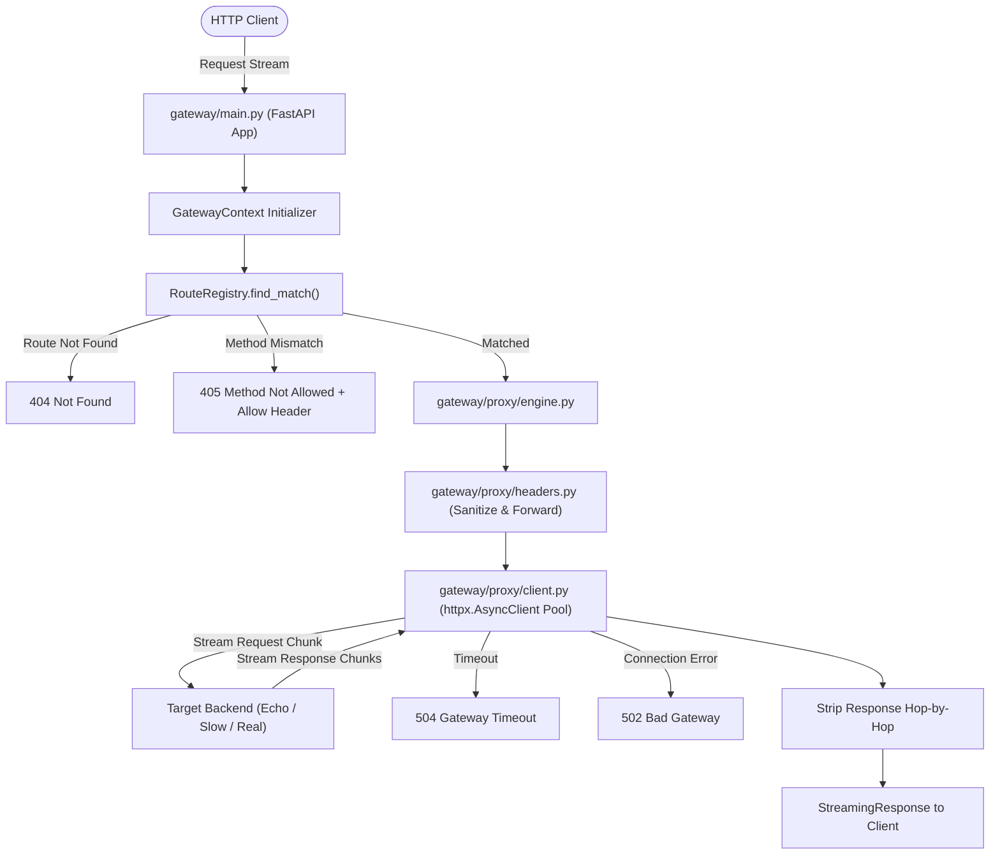

# Phase 2 Implementation Plan: Request Proxying & Header Handling Engine

## Phase 1 Sign-Off Verification

Before initiating Phase 2, we verified all deliverables from **Phase 1: Core Foundation & Data Models**:
- [x] **Data Models**: [gateway/models/route.py](file:///Users/yairtaboch/PycharmProjects/mountain_api_gateway/gateway/models/route.py), [backend.py](file:///Users/yairtaboch/PycharmProjects/mountain_api_gateway/gateway/models/backend.py), [context.py](file:///Users/yairtaboch/PycharmProjects/mountain_api_gateway/gateway/models/context.py), and [config.py](file:///Users/yairtaboch/PycharmProjects/mountain_api_gateway/gateway/config.py) implemented with Pydantic v2.
- [x] **Route Matching**: [gateway/routing/matcher.py](file:///Users/yairtaboch/PycharmProjects/mountain_api_gateway/gateway/routing/matcher.py) supports exact paths, single wildcard (`*`), recursive globs (`**`), path parameter extraction (`{param}`), specificity ranking, and explicit priority overrides.
- [x] **Route Registry**: [gateway/routing/registry.py](file:///Users/yairtaboch/PycharmProjects/mountain_api_gateway/gateway/routing/registry.py) supports concurrency-safe in-memory operations and JSON disk persistence round-tripping.
- [x] **Verification**: All 13 tests pass in `tests/test_route_matching.py`. Ruff linting/formatting and Pyright static type checking pass with 0 errors.

---

## Goal Description

Build the **Request Proxying & Header Handling Engine** (Phase 2), connecting incoming client requests to upstream services with true streaming, RFC-compliant header sanitization, path translation, connection pooling, and fault handling.

Key objectives:
1. **True ASGI Streaming**: Stream incoming request payloads to upstreams (`request.stream()`) and stream responses back to clients (`response.aiter_raw()`) without buffering whole bodies in memory.
2. **RFC 7230 §6.1 Header Sanitization**:
   - Strip all hop-by-hop headers (`Connection`, `Keep-Alive`, `Proxy-Authenticate`, `Proxy-Authorization`, `TE`, `Trailers`, `Transfer-Encoding`, `Upgrade`).
   - Strip dynamic headers specified in client `Connection` header tokens.
   - Clean up `Content-Length` on chunked/streaming requests to prevent desynchronization.
3. **Forwarding & Identity Tracking**:
   - Rewrite `Host` header to target backend authority, while storing the client host in `X-Forwarded-Host`.
   - Append client IP to `X-Forwarded-For` chain and set `X-Real-IP`.
   - Propagate or generate `X-Request-ID` across the request boundary.
4. **Resilient Failure Handling**:
   - Translate upstream timeouts to HTTP `504 Gateway Timeout`.
   - Translate connection refusals / DNS failures / crashes to HTTP `502 Bad Gateway`.
   - Return clean, structured error responses (`error`, `message`, `request_id`, `timestamp`) with zero Python stack trace leakage.
   - Return HTTP `404 Not Found` when no route matches, and HTTP `405 Method Not Allowed` with `Allow` header when the path matches other methods.
5. **Mock Backend Services**: Provide `echo_service` and `slow_service` for end-to-end integration and automated verification.

---

## User Review Required

> [!IMPORTANT]
> **Streaming Body Replayability:**
> In true streaming mode, request body chunks are consumed as an async iterator directly into the upstream socket. If an upstream attempt fails after chunks have been dispatched, the body stream is exhausted and cannot be retried without caching in memory/disk. For Phase 2, proxying is a single-shot streaming request (retries/circuit breaking will be layered in Phase 4 for idempotent requests).

> [!NOTE]
> **FastAPI / ASGI Catch-All Dispatcher:**
> The gateway application entry point (`gateway/main.py`) will mount a catch-all ASGI route (`/{full_path:path}`) to route requests through the dynamic `RouteRegistry` rather than hardcoding static endpoint paths.

---

## Proposed Changes



---

### Component 1: Header Sanitization & Transformation (`gateway/proxy/headers.py`)

#### [NEW] `gateway/proxy/headers.py`
- Implements `prepare_upstream_headers(incoming_headers, client_host, client_ip, target_url, request_id)`:
  - Parses hop-by-hop headers according to RFC 7230 §6.1.
  - Inspects `Connection` value (e.g. `Connection: close, X-Custom-Hop`) and adds custom tokens to the hop-by-hop discard set.
  - Rewrites `Host` to `target_url.netloc`.
  - Preserves incoming `X-Forwarded-Host` or sets it to original `Host`.
  - Sets `X-Forwarded-Proto` (`http` / `https`).
  - Sets `X-Forwarded-Port`.
  - Appends `client_ip` to `X-Forwarded-For`.
  - Injects `X-Request-ID`.
- Implements `prepare_client_response_headers(upstream_headers)`:
  - Strips hop-by-hop response headers (`connection`, `keep-alive`, `transfer-encoding`, `upgrade`, etc.).
  - Strips any response `content-length` when streaming to prevent chunked/length mismatch hangs.

---

### Component 2: Async HTTP Client Pool (`gateway/proxy/client.py`)

#### [NEW] `gateway/proxy/client.py`
- Singleton/managed `ProxyHttpClientPool`:
  - Configures `httpx.AsyncClient` with `httpx.Limits(max_connections=1000, max_keepalive_connections=100, keepalive_expiry=30.0)`.
  - Disables automatic redirects (`follow_redirects=False`) so gateway forwards 3xx redirects to client intact.
  - Exposes `startup()` and `shutdown()` hooks for ASGI lifecycle.

---

### Component 3: Streaming Proxy Engine (`gateway/proxy/engine.py`)

#### [NEW] `gateway/proxy/engine.py`
- Handles streaming dispatch:
  - Resolves target URL by joining upstream base URL with `target_path` and preserving client query string.
  - Constructs `httpx.Request` with `content=request.stream()` to stream chunks without loading into memory.
  - Sends request using configured per-route `timeout_seconds`.
  - Wraps response in Starlette/FastAPI `StreamingResponse(response.aiter_raw(), status_code=response.status_code, headers=clean_headers)`.
  - Translates `httpx.TimeoutException` -> 504 Gateway Timeout.
  - Translates `httpx.ConnectError`, `httpx.NetworkError` -> 502 Bad Gateway.
  - Returns unified JSON error:
    ```json
    {
      "error": "gateway_timeout",
      "message": "Upstream backend did not respond within 5.0 seconds",
      "request_id": "...",
      "timestamp": "2026-10-27T18:40:00Z"
    }
    ```

---

### Component 4: Mock Backend Services (`mock_backend_services/`)

#### [NEW] `mock_backend_services/echo_service.py`
- Fast standalone ASGI app returning received method, URL, headers, query parameters, and raw body.

#### [NEW] `mock_backend_services/slow_service.py`
- Fast standalone ASGI app taking `?delay=X` query param, awaiting delay before returning 200 OK.

---

### Component 5: Gateway ASGI Application & API Documentation (`gateway/main.py`)

#### [NEW] `gateway/main.py`
- FastAPI app with lifespan manager (initializing HTTP client pool and route registry).
- **Reserved System Routes**: Ensure system endpoints are prioritized before the catch-all proxy route:
  - Interactive Swagger Documentation at `/docs` (and ReDoc at `/redoc`, OpenAPI JSON at `/openapi.json`).
  - OpenAPI description enriched with a comprehensive **Gateway Client Guide**:
    - How requests are routed (exact vs pattern vs glob matching).
    - Header handling (hop-by-hop stripping, `X-Request-ID` propagation, `X-Forwarded-*`).
    - Standard error schemas (400, 401, 403, 404, 405, 429, 502, 504).
    - Query parameter and body streaming semantics.
  - Gateway health probe: `GET /health` -> `{"status": "ok"}`.
  - Optional Gateway API Guide endpoint: `GET /api/guide` -> structured JSON guide detailing route conventions, headers, and error codes for programmatic discovery.
- **Catch-all Proxy Handler**: `/{full_path:path}` (handles GET, POST, PUT, DELETE, PATCH, HEAD, OPTIONS):
  - Skips reserved routes (`/health`, `/docs`, `/redoc`, `/openapi.json`, `/api/guide`).
  - Extracts client context (IP, Request ID, start time).
  - Matches route using `RouteRegistry.find_match(method, path)`.
  - If no match found: checks if path matches with different method using `RouteRegistry.get_allowed_methods(path)`.
    - If allowed methods exist: returns 405 Method Not Allowed with `Allow: <methods>` header.
    - Otherwise: returns 404 Not Found.
  - Delegates execution to Proxy Engine.

---

### Component 6: Comprehensive Automated Tests (`tests/`)

#### [NEW] `tests/test_request_proxying.py`
- Tests GET, POST, PUT, DELETE requests against mock echo service.
- Tests query parameter forwarding and preservation.
- Tests body streaming without data truncation or corruption.
- Tests path stripping (`strip_prefix`) and path prefixing (`add_prefix`).
- Tests upstream status code pass-through (200, 201, 400, 404, 500).

#### [NEW] `tests/test_header_transform.py`
- Tests RFC 7230 hop-by-hop header removal from request (`Connection`, `Keep-Alive`, `Upgrade`, etc.).
- Tests dynamic hop-by-hop header removal via `Connection: close, X-Custom-Header`.
- Tests `Host` rewriting to upstream target and preservation of `X-Forwarded-Host`.
- Tests `X-Forwarded-For` chain concatenation (`client, proxy1`).
- Tests `X-Real-IP` injection.
- Tests `X-Request-ID` generation and upstream forwarding.
- Tests response hop-by-hop header removal.

#### [NEW] `tests/test_error_handling.py`
- Tests upstream timeout returning HTTP 504 with structured error schema.
- Tests unreachable / stopped upstream returning HTTP 502 with structured error schema.
- Tests unknown route returning HTTP 404.
- Tests method mismatch returning HTTP 405 with `Allow` header.
- Asserts no internal Python stack traces or sensitive URLs leaked in error payloads.
- Tests `/docs`, `/openapi.json`, and `/api/guide` return 200 OK with proper client documentation, and are not trapped by the catch-all proxy.

---

## Verification Plan

### Automated Tests
Execute the full test suite including Phase 1 and new Phase 2 test suites:
```bash
uv run pytest -v
```

Linting and formatting verification:
```bash
uv run ruff check . && uv run ruff format --check .
```

Static type check:
```bash
uv run pyright
```

### Manual Verification
1. Spin up Gateway and Mock Services using `docker-compose.yml` or local ASGI runner.
2. Run `curl` requests demonstrating:
   - Proxying to Echo Service: `curl -i -X POST http://localhost:8000/api/v1/echo -d '{"hello": "world"}'`
   - Hop-by-hop stripping: `curl -i -H "Connection: close, X-Foo" -H "X-Foo: bar" http://localhost:8000/api/v1/echo`
   - Timeout to Slow Service: `curl -i "http://localhost:8000/api/v1/slow?delay=10"` (configured with 2s timeout) -> expect 504.
   - Connection failure to dead port: route configured to `http://localhost:9999` -> expect 502.
