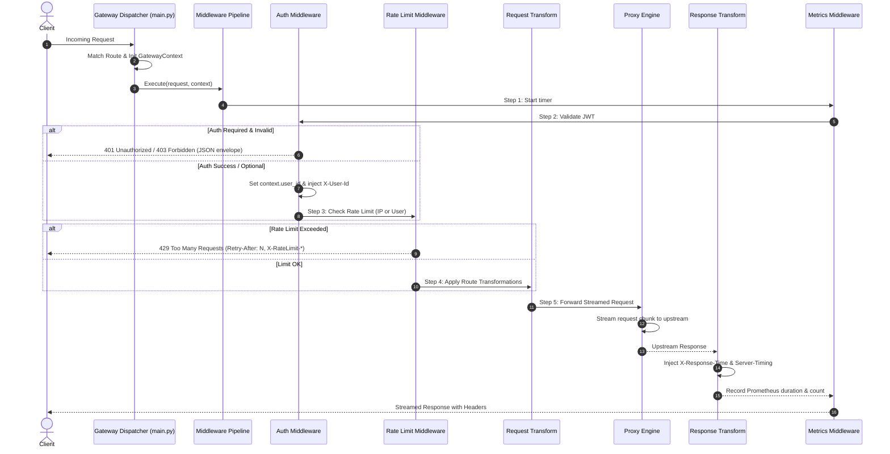

# Phase 3 Implementation Plan: Middleware Subsystem

## Goal Description

Build the **Middleware Subsystem** (Phase 3), providing an asynchronous Chain-of-Responsibility pipeline for cross-cutting concerns:
1. **Pipeline Orchestrator & Base Interface**: Clean async interface (`execute(request, context, call_next)`) executing middleware in strict sequence, safely passing state through `GatewayContext`.
2. **Authentication Middleware**: JWT token validation (`HS256`/`RS256`), expiration/signature verification, required vs optional modes, role/scope authorization, and upstream user identity injection (`X-User-Id`, `X-User-Roles`).
3. **Rate Limiting Middleware**: Sliding-window rate limiter with primary Redis backend and transparent high-performance in-memory fallback. Identity keying by IP, authenticated user ID, or API key. Standard rate limit headers (`X-RateLimit-*`) and HTTP 429 with `Retry-After`.
4. **Request & Response Transformations**: Route-specific header additions/removals, latency measurement (`Server-Timing`, `X-Response-Time`), and CORS headers.
5. **Observability**: Prometheus metrics (`/metrics`) tracking request count, latencies, and rate limit rejections, paired with structured JSON access logging.

---

## User Review Required

> [!IMPORTANT]
> **Redis Dual-Backend & High Availability Strategy**:
> To ensure zero downtime if Redis is unavailable or disconnected, the Rate Limiter will implement a dual-mode engine: it will attempt Redis atomic sliding-window operations, and automatically fall back to an in-memory thread-safe sliding window if Redis times out or is unreachable.

> [!NOTE]
> **Pipeline Ordering & Early Exit**:
> Middleware executes in strict order:
> 1. `MetricsMiddleware` (outermost: starts timer, records final status/latency)
> 2. `AuthMiddleware` (verifies JWT, populates `context.user_id`, injects `X-User-*`)
> 3. `RateLimitMiddleware` (evaluates quota based on IP or authenticated `user_id`, returns 429 on exhaustion)
> 4. `RequestTransformMiddleware` (adds/removes headers before proxying)
> 5. Terminal: `ProxyEngine` (streams request to upstream backend)
> 6. `ResponseTransformMiddleware` (adds timing headers, CORS, custom response headers)

---

## Proposed Architecture & Pipeline Flow



---

## Proposed Changes

```
gateway/
├── middleware/
│   ├── __init__.py
│   ├── base.py              # BaseMiddleware protocol & Pipeline orchestrator
│   ├── auth.py              # JWT validation, claims extraction, scope & role checks
│   ├── rate_limit.py        # Redis + In-Memory sliding-window rate limiter
│   ├── request_transform.py # Header additions/removals per route config
│   ├── response_transform.py# Timing headers (Server-Timing), CORS, custom headers
│   └── metrics.py           # Prometheus counters/histograms & /metrics endpoint
```

---

### Component 1: Base Middleware Interface & Pipeline (`gateway/middleware/base.py`)

#### [NEW] `gateway/middleware/base.py`
- Defines `CallNext = Callable[[Request, GatewayContext], Awaitable[Response]]`.
- Defines abstract base class `BaseMiddleware`:
  ```python
  class BaseMiddleware(ABC):
      @abstractmethod
      async def __call__(
          self,
          request: Request,
          context: GatewayContext,
          call_next: CallNext,
      ) -> Response:
          pass
  ```
- Defines `MiddlewarePipeline`:
  - Chains an ordered list of `BaseMiddleware` instances.
  - Final handler delegates to terminal handler (Proxy Engine).
  - Traps unhandled exceptions to return standard 500 JSON without exposing stack traces.

---

### Component 2: Authentication Middleware (`gateway/middleware/auth.py`)

#### [NEW] `gateway/middleware/auth.py`
- Inspects `context.matched_route.middleware.auth`:
  - If `enabled=False`: immediately passes to `call_next`.
  - If `enabled=True` and `required=False`: attempts token extraction if `Authorization` header present; if absent, proceeds anonymously.
  - If `enabled=True` and `required=True`: strictly requires valid `Bearer <token>`.
- Token Verification:
  - Decodes and verifies JWT with `settings.jwt_secret` and `settings.jwt_algorithm`.
  - Checks expiration (`exp`) and not-before (`nbf`).
  - Populates `context.user_id = payload.get("sub") or payload.get("user_id")`.
  - Populates `context.user_roles = payload.get("roles", [])`.
  - Stores all claims in `context.auth_claims`.
- Authorization (Role & Scope checks):
  - If `allowed_roles` configured: verifies user has at least one matching role -> returns `403 Forbidden` if missing.
  - If `required_scopes` configured: verifies token has all required scopes -> returns `403 Forbidden` if missing.
- Upstream User Identity Propagation:
  - Injects `X-User-Id` and `X-User-Roles` into request headers before forwarding.

---

### Component 3: Rate Limiting Subsystem (`gateway/middleware/rate_limit.py`)

#### [NEW] `gateway/middleware/rate_limit.py`
- Inspects `context.matched_route.middleware.rate_limit`:
  - If `enabled=False`: passes to `call_next`.
- Dual-Backend Architecture:
  - **`RedisRateLimitEngine`**: Atomic sliding-window log using sorted sets (`ZADD`, `ZREMRANGEBYSCORE`, `ZCARD`, `EXPIRE`) or Lua script.
  - **`InMemoryRateLimitEngine`**: Thread-safe in-memory sliding window using timestamps and deque with automatic eviction.
  - **Fallback Logic**: If Redis is unreachable or raises a connection error, gracefully falls back to the in-memory engine.
- Key Resolution:
  - If `key_by == "user"`: uses `context.user_id` (fallback to client IP if unauthenticated).
  - If `key_by == "api_key"`: uses `request.headers.get("x-api-key")` (fallback to client IP).
  - Otherwise (`key_by == "ip"`): uses `context.client_ip`.
- Response Headers:
  - Injects `X-RateLimit-Limit`, `X-RateLimit-Remaining`, `X-RateLimit-Reset` on all matched requests.
- Limit Exceeded:
  - Returns HTTP `429 Too Many Requests` with `Retry-After: <seconds>` and structured error envelope:
    ```json
    {
      "error": "rate_limit_exceeded",
      "message": "Rate limit exceeded. Try again in 8 seconds",
      "request_id": "<uuid>",
      "timestamp": "<iso8601>"
    }
    ```

---

### Component 4: Request & Response Transformations (`gateway/middleware/`)

#### [NEW] `gateway/middleware/request_transform.py`
- Injects `add_request_headers` from route config.
- Removes `remove_request_headers` from route config.

#### [NEW] `gateway/middleware/response_transform.py`
- Calculates total gateway execution latency: `(time.perf_counter() - context.start_time) * 1000`.
- Injects `X-Response-Time: {latency_ms:.2f}ms`.
- Injects `Server-Timing: gateway;dur={latency_ms:.2f}`.
- Injects `add_response_headers` from route config.

---

### Component 5: Metrics & Observability (`gateway/middleware/metrics.py`)

#### [NEW] `gateway/middleware/metrics.py`
- Prometheus counters and histograms:
  - `gateway_requests_total`: Labels `[method, route_id, status_code]`
  - `gateway_request_duration_seconds`: Histogram with standard latency buckets
  - `gateway_rate_limited_total`: Labels `[route_id, key_by]`
- `/metrics` Endpoint:
  - Serves Prometheus exposition format via `prometheus_client.generate_latest()`.
- Access Logger:
  - Structured log line: timestamp, method, path, status, latency_ms, client_ip, request_id, user_id.

---

### Component 6: Integration with Gateway Application (`gateway/main.py`)

#### [MODIFY] `gateway/main.py`
- Add `/metrics` to `RESERVED_SYSTEM_PATHS` so it serves Prometheus metrics directly.
- Initialize `MiddlewarePipeline` with:
  1. `MetricsMiddleware`
  2. `AuthMiddleware`
  3. `RateLimitMiddleware`
  4. `RequestTransformMiddleware`
  5. `ResponseTransformMiddleware`
- In `catch_all_proxy`, run matched requests through the pipeline before returning response to client.

---

### Component 7: Comprehensive Automated Tests (`tests/`)

#### [NEW] `tests/test_auth_middleware.py`
- Test valid JWT authenticates and populates `X-User-Id` and `X-User-Roles`.
- Test expired JWT returns 401 with `token_expired`.
- Test invalid signature returns 401 with `invalid_token`.
- Test missing token when auth is required returns 401 with `unauthorized`.
- Test missing token when auth is optional allows anonymous request.
- Test role validation returns 403 when user lacks required role.
- Test scope validation returns 403 when user lacks required scope.

#### [NEW] `tests/test_rate_limiting.py`
- Test requests below limit succeed with correct `X-RateLimit-*` headers.
- Test exceeding limit returns 429 with `Retry-After` header.
- Test rate limit keying by IP vs authenticated user ID.
- Test in-memory fallback operates seamlessly when Redis is absent.

#### [NEW] `tests/test_middleware_pipeline.py`
- Test full end-to-end pipeline execution (Auth + Rate Limit + Transforms + Proxy).
- Test `X-Response-Time` and `Server-Timing` headers present on responses.
- Test route-configured header injection (`add_request_headers`, `add_response_headers`).
- Test `/metrics` endpoint returns Prometheus metrics for proxied requests.

---

## Verification Plan

### Automated Tests
Run entire test suite:
```bash
uv run pytest -v
```

Code quality and typing validation:
```bash
uv run ruff check . && uv run ruff format --check .
uv run pyright
```

### Manual Verification
1. Generate test JWT tokens with Python script.
2. Send curl requests to authenticated routes:
   - Without token -> verify 401.
   - With invalid token -> verify 401.
   - With valid token -> verify 200 and check `X-User-Id` received by echo backend.
3. Burst 20 requests in loop -> verify 429 received with `Retry-After` header.
4. Check `curl http://localhost:8000/metrics` -> verify Prometheus metrics output.
