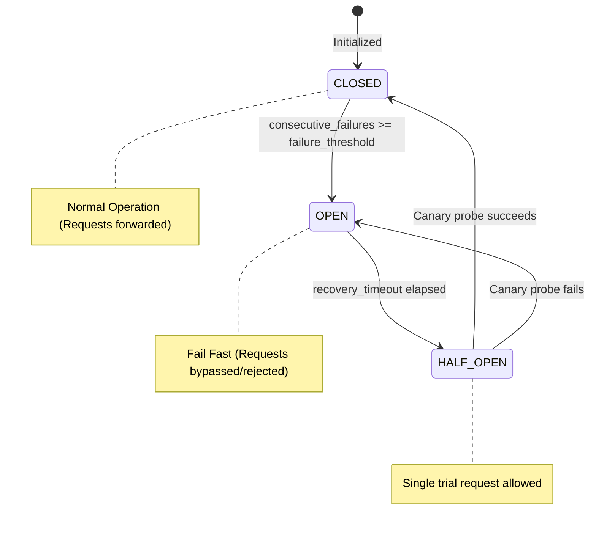
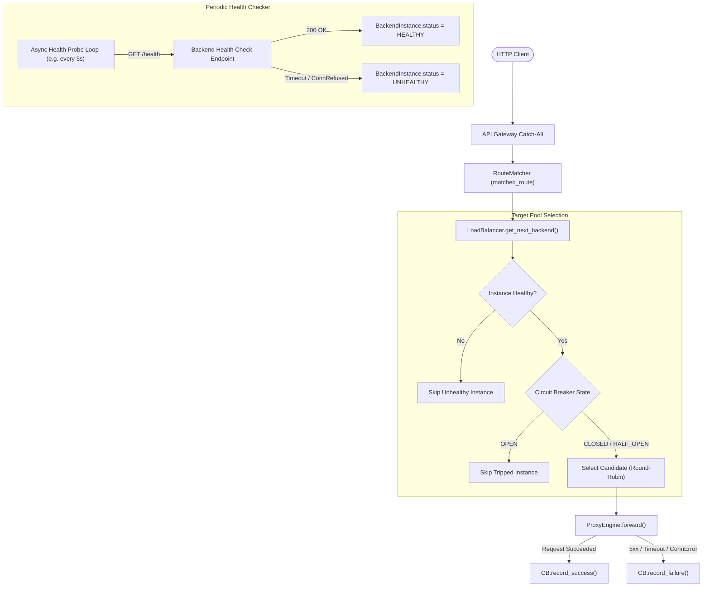

# Phase 4 Implementation Plan: Service Discovery, Load Balancing & Health Checks

## Goal Description

Build the **Service Discovery, Load Balancing & Health Checking Engine** (Phase 4), allowing routes to distribute traffic across pools of upstream instances, automatically isolate dead backends, and maintain high availability:
1. **Target Pools & Multi-Backend Routes**: Extend `RouteDefinition` to support upstream target pools (`upstream_pool: list[BackendInstance]`) alongside existing single `upstream_url`.
2. **Load Balancing Engine**: Provide Round-Robin (and weighted) traffic distribution across healthy backend instances, skipping failed nodes.
3. **Circuit Breaker Pattern**: Three-state finite state machine (`CLOSED` -> `OPEN` -> `HALF_OPEN`) per backend instance to fail fast and prevent cascading network exhaustion when backends fail.
4. **Background Health Checking**: Periodic async background worker polling upstream health probes (`/health`) with configurable intervals, marking instances `HEALTHY` or `UNHEALTHY`.
5. **Failover & Zero Pool Handling**: Transparent failover to healthy alternatives when a node drops; return structured HTTP `503 Service Unavailable` if the entire pool is dead.

---

## User Review Required

> [!IMPORTANT]
> **Circuit Breaker Thresholds & Timeouts**:
> - `failure_threshold`: Default 3 consecutive failures trips the circuit from `CLOSED` to `OPEN`.
> - `recovery_timeout`: Default 5.0 seconds in `OPEN` state before transitioning to `HALF_OPEN` to permit a canary probe.
> - `success_threshold`: 1 successful probe in `HALF_OPEN` resets circuit to `CLOSED`.

> [!NOTE]
> **Backward Compatibility**:
> Routes defined with a single `upstream_url: str` continue to work unchanged. When a route defines multiple backends via `upstream_pool`, the Load Balancer dynamically balances traffic across the pool.

---

## System Architecture & State Machine





---

## Proposed Changes

```
gateway/
├── discovery/
│   ├── __init__.py
│   ├── circuit_breaker.py   # CircuitBreaker state machine (CLOSED/OPEN/HALF_OPEN)
│   ├── load_balancer.py     # RoundRobin & Weighted load balancing over target pools
│   └── health_checker.py    # Background periodic async health polling
```

---

### Component 1: Circuit Breaker State Machine (`gateway/discovery/circuit_breaker.py`)

#### [NEW] `gateway/discovery/circuit_breaker.py`
- `CircuitState` enum: `CLOSED`, `OPEN`, `HALF_OPEN`.
- `CircuitBreaker` class:
  - Configurable parameters: `failure_threshold: int = 3`, `recovery_timeout_seconds: float = 5.0`.
  - Methods:
    - `can_execute() -> bool`: Returns `True` if `CLOSED` or if `OPEN` and recovery timeout has elapsed (transitions to `HALF_OPEN`).
    - `record_success() -> None`: Resets consecutive failures to 0; transitions `HALF_OPEN` -> `CLOSED`.
    - `record_failure() -> None`: Increments consecutive failures; if threshold reached, transitions to `OPEN` and records trip timestamp.
    - `state -> CircuitState`: Current state inspection.

---

### Component 2: Load Balancer (`gateway/discovery/load_balancer.py`)

#### [NEW] `gateway/discovery/load_balancer.py`
- `LoadBalancer` class:
  - Manages `CircuitBreaker` instances keyed by backend URL.
  - Resolves target backend for a given route:
    - If route has only single `upstream_url`, evaluates its circuit breaker.
    - If route has `upstream_pool`, filters instances where `status == HealthStatus.HEALTHY` and `circuit_breaker.can_execute() == True`.
    - Cycles through eligible healthy backends using Round-Robin pointer.
  - If no healthy instances remain: raises `NoHealthyBackendException`.
  - In `ProxyEngine` / Gateway: `NoHealthyBackendException` translates to clean HTTP `503 Service Unavailable`:
    ```json
    {
      "error": "service_unavailable",
      "message": "No healthy upstream backend instances available in target pool",
      "request_id": "<uuid>",
      "timestamp": "<iso8601>"
    }
    ```

---

### Component 3: Periodic Async Health Checker (`gateway/discovery/health_checker.py`)

#### [NEW] `gateway/discovery/health_checker.py`
- `HealthChecker` class:
  - Runs background async loop: `while self._running: await asyncio.sleep(interval_seconds); await self.check_all()`.
  - Probes each backend URL: `GET {backend_url}{health_path}` (default `/health`, timeout 1.5s).
  - Updates `BackendInstance`:
    - On HTTP 2xx: sets `status = HealthStatus.HEALTHY`, `consecutive_failures = 0`.
    - On Timeout/Connection error/5xx: increments `consecutive_failures`; if `>= threshold`, sets `status = HealthStatus.UNHEALTHY`.
  - Lifecycle management: `start()` and `stop()` hooks managed by FastAPI application lifespan.

---

### Component 4: Integration with Gateway Models & Routing

#### [MODIFY] `gateway/models/route.py`
- Add `upstream_pool: list[BackendInstance] = Field(default_factory=list)` to `RouteDefinition`.
- If `upstream_pool` is empty, fallback to single `upstream_url`.

#### [MODIFY] `gateway/main.py`
- Initialize `LoadBalancer` and `HealthChecker` on `app.state`.
- Start health checker during lifespan startup, stop during lifespan shutdown.
- Add `GET /admin/backends` endpoint returning inventory of all backends, health statuses, failure counts, and circuit breaker states.
- Catch `NoHealthyBackendException` -> return 503 JSON envelope.

---

### Component 5: Comprehensive Automated Tests (`tests/test_service_discovery.py`)

#### [NEW] `tests/test_service_discovery.py`
- **Round-Robin Load Balancing**: Route with 3 mock backends receives 6 sequential requests; assert distribution is evenly balanced (2 requests per backend).
- **Health Check Detection**: Background probe detects dead backend, marks it `UNHEALTHY`, and subsequent proxy requests bypass it.
- **Failover**: When one backend in a 2-backend pool fails, all traffic routes seamlessly to the remaining healthy backend.
- **Circuit Breaker Tripping**: After 3 consecutive network failures to a backend, circuit breaker trips to `OPEN`, immediately failing fast without sending network requests.
- **Circuit Breaker Recovery**: After recovery timeout, circuit enters `HALF_OPEN`, successful canary probe restores it to `CLOSED`.
- **Pool Exhaustion (503)**: When all backends in a pool are down, gateway returns structured HTTP 503 `service_unavailable`.
- **Admin Backend Inventory**: Verify `GET /admin/backends` reports correct health and circuit breaker metrics.

---

## Verification Plan

### Automated Tests
Run full test suite:
```bash
uv run pytest -v
```

Code quality and typing validation:
```bash
uv run ruff check . && uv run ruff format --check .
uv run pyright
```

### Manual Verification
1. Configure a multi-backend route with 2 mock services (`echo_1` on port 8001, `echo_2` on port 8002).
2. Send curl loop: `for i in {1..4}; do curl http://localhost:8000/api/pool; done` -> observe alternating backend URLs in response.
3. Stop `echo_2` -> send requests -> observe 100% traffic directed to `echo_1`.
4. Inspect `curl http://localhost:8000/admin/backends` -> verify `echo_2` marked `unhealthy`.
