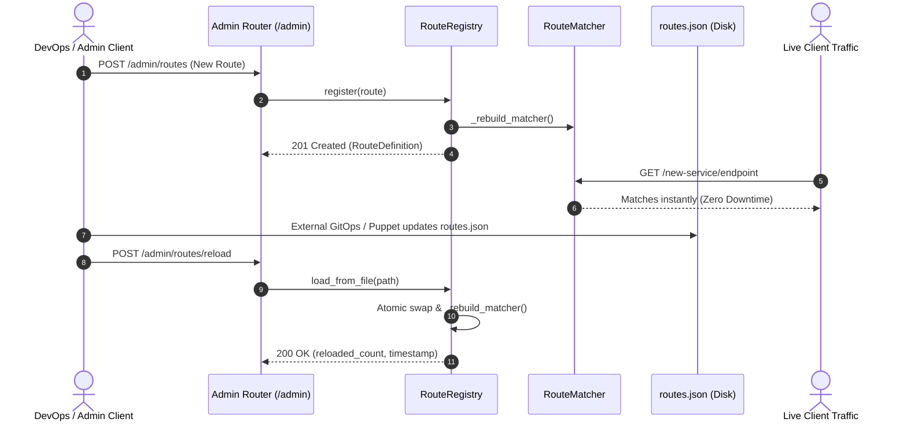

# Phase 5: Admin API & Hot Configuration Reload — Implementation Plan

## Goal Description
Implement an interview-grade, dynamic **Admin API Subsystem** providing runtime administration and **Zero-Downtime Hot Configuration Reload** for the Mountain API Gateway:
1. **Dynamic Route CRUD**: Full REST lifecycle management (`POST`, `GET`, `PUT`, `DELETE`) for route definitions with instant in-memory compilation.
2. **Route Status Toggling**: Non-destructive route disable/enable (`PATCH /admin/routes/{id}/status`) to take backends out of rotation without deleting configuration.
3. **Observability & Diagnostics**: Dedicated `/admin/health` and `/admin/stats` endpoints reporting uptime, active routes, and backend health summaries.
4. **Zero-Downtime Hot Reload**: Dynamic reload from disk or payload (`POST /admin/routes/reload`) atomically updating the in-memory `RouteMatcher` and `RouteRegistry` without restarting the gateway process or dropping in-flight connections.

---

## Architecture & Interaction Workflow



---

## User Review Required

> [!NOTE]
> All Admin API models will be built as standard Pydantic `BaseModel` classes, ensuring strong schema validation, automatic OpenAPI `/docs` documentation, and type-safety.

> [!IMPORTANT]
> **Duplicate Route IDs on `POST /admin/routes`**:
> We will return `HTTP 409 Conflict` if a client attempts to `POST` a route with an ID that already exists in the registry. To overwrite or update an existing route, `PUT /admin/routes/{id}` must be used.

> [!TIP]
> **Persistence Auto-Save**:
> When `settings.routes_file_path` is configured (or explicitly set on the registry), mutating operations (`POST`, `PUT`, `DELETE`, `PATCH /status`) will automatically persist to disk asynchronously.

---

## Proposed Changes

### 1. Admin Models ([gateway/models/admin.py](file:///Users/yairtaboch/PycharmProjects/mountain_api_gateway/gateway/models/admin.py))
#### [NEW] `gateway/models/admin.py`
Define Pydantic models for admin API requests, responses, stats, and health:
- `RouteStatusUpdate(BaseModel)`: `{"enabled": bool}` for `PATCH /admin/routes/{id}/status`.
- `GatewayHealth(BaseModel)`: Detailed gateway health status, service name, uptime seconds, and timestamp.
- `GatewayStats(BaseModel)`: Total routes, active routes, disabled routes, total registered backends, healthy backends, and degraded backends.
- `ReloadResult(BaseModel)`: Success indicator, total routes loaded, source file path, and reloaded timestamp.

```python
from datetime import datetime
from pydantic import BaseModel, Field


class RouteStatusUpdate(BaseModel):
    enabled: bool


class GatewayHealth(BaseModel):
    status: str = "healthy"
    service: str = "mountain-api-gateway"
    version: str = "0.1.0"
    uptime_seconds: float
    timestamp: datetime


class GatewayStats(BaseModel):
    total_routes: int
    active_routes: int
    disabled_routes: int
    total_backends: int
    healthy_backends: int
    unhealthy_backends: int


class ReloadResult(BaseModel):
    success: bool
    reloaded_count: int
    source: str
    reloaded_at: datetime
```

---

### 2. Registry Enhancements ([gateway/routing/registry.py](file:///Users/yairtaboch/PycharmProjects/mountain_api_gateway/gateway/routing/registry.py))
#### [MODIFY] `gateway/routing/registry.py`
Add convenience methods and file path state to `RouteRegistry`:
- `file_path: Path | None`: Remember source file path for automatic persistence and default reload target.
- `exists(route_id: str) -> bool`: Fast existence check.
- `set_status(route_id: str, enabled: bool) -> RouteDefinition | None`: Atomically toggle route status and rebuild compiled matcher.

```python
    async def set_status(self, route_id: str, enabled: bool) -> RouteDefinition | None:
        async with self._lock:
            route = self._routes.get(route_id)
            if not route:
                return None
            route.enabled = enabled
            self._rebuild_matcher()
            if self.file_path:
                await self.save_to_file(self.file_path)
            return route
```

---

### 3. Admin API Router ([gateway/admin/routes.py](file:///Users/yairtaboch/PycharmProjects/mountain_api_gateway/gateway/admin/routes.py))
#### [NEW] `gateway/admin/__init__.py`
#### [NEW] `gateway/admin/routes.py`
Implement FastAPI `APIRouter(prefix="/admin", tags=["Admin"])`:
- `POST /admin/routes`: Create route. Returns `201 Created` with route schema; `409 Conflict` if route `id` already exists.
- `GET /admin/routes`: List routes. Query parameter `include_disabled: bool = True` (returns `list[RouteDefinition]`).
- `GET /admin/routes/{route_id}`: Get single route. Returns `200 OK` or `404 Not Found`.
- `PUT /admin/routes/{route_id}`: Replace route. Returns `200 OK` or `404 Not Found`.
- `DELETE /admin/routes/{route_id}`: Remove route. Returns `200 OK` with `{"message": "deleted"}` or `404 Not Found`.
- `PATCH /admin/routes/{route_id}/status`: Toggle enabled status (`RouteStatusUpdate`). Returns `200 OK` with updated route or `404 Not Found`.
- `GET /admin/health`: Detailed gateway uptime, health check, and system info (`GatewayHealth`).
- `GET /admin/stats`: Aggregate count of routes and healthy backends (`GatewayStats`).
- `GET /admin/backends`: Existing Phase 4 backend status report (`list[BackendStatus]`).
- `POST /admin/routes/reload`: Hot-reload routes from `file_path` or request body without restart. Returns `ReloadResult`.

---

### 4. App Mounting ([gateway/main.py](file:///Users/yairtaboch/PycharmProjects/mountain_api_gateway/gateway/main.py))
#### [MODIFY] `gateway/main.py`
- Mount `admin_router` with `app.include_router(admin_router)`.
- Store `start_time` on `app.state.start_time` for uptime tracking in `/admin/health`.
- Keep existing `/health` and `/api/guide` as public system endpoints.

---

## Verification Plan

### Automated Tests
Run dedicated Admin API test suite with `uv run pytest -v tests/test_admin_api.py`:
1. **CRUD Operations**:
   - `test_create_route_success`: Valid `POST /admin/routes` returns 201 and route is immediately matchable.
   - `test_create_route_conflict`: Duplicate route ID returns 409 Conflict.
   - `test_list_routes`: `GET /admin/routes` filters by `include_disabled`.
   - `test_get_route_by_id`: 200 on existing, 404 on missing.
   - `test_update_route`: `PUT /admin/routes/{id}` updates path, methods, and upstream; immediately active in proxy.
   - `test_delete_route`: `DELETE /admin/routes/{id}` removes route; subsequent requests to that path return 404.
2. **Status Toggling**:
   - `test_patch_route_status_disable_and_enable`: `PATCH /admin/routes/{id}/status` with `{"enabled": false}` disables route; gateway immediately ignores it (404); enabling it restores traffic.
3. **Observability**:
   - `test_admin_health`: Returns 200 with valid uptime and service name.
   - `test_admin_stats`: Correctly aggregates route counts (total, active, disabled) and backend states.
4. **Hot Reload**:
   - `test_hot_reload_from_disk_zero_downtime`: Modifies disk JSON file while gateway is running, calls `POST /admin/routes/reload`, and verifies new route is immediately live without process restart.
   - `test_hot_reload_missing_file_returns_400`: Graceful error when reload target file does not exist.

### Quality Assurance Commands
```bash
uv run pytest -v
uv run ruff check .
uv run ruff format --check .
uv run pyright
```
